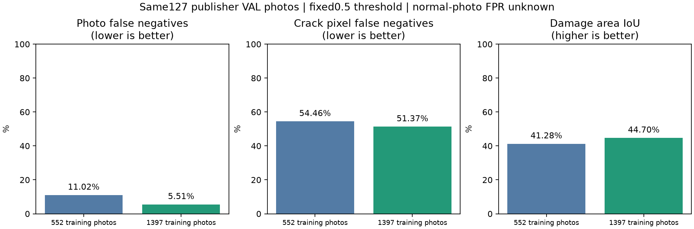
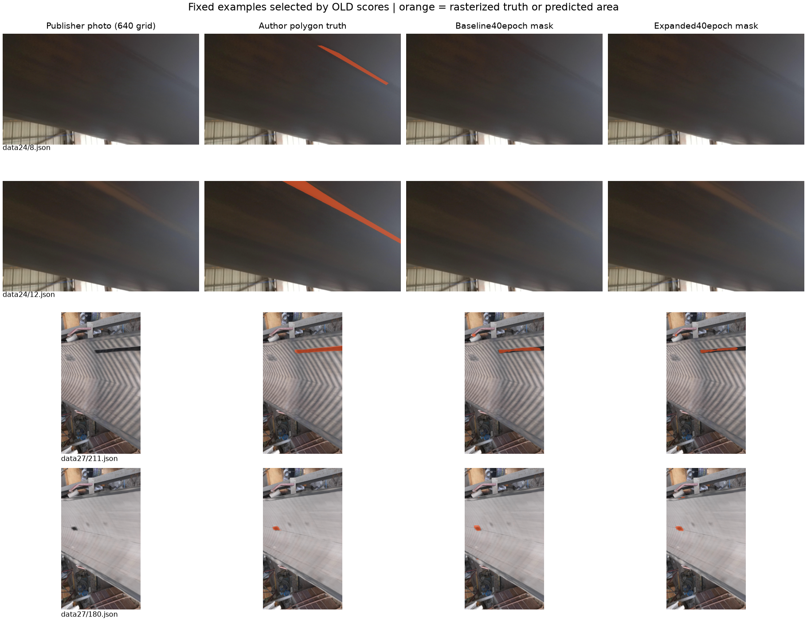

# 컨베이어 벨트 원본 사진 확대: 실제 학습 결과

## 변경 내용

공식 [BeltCrack V1](https://doi.org/10.57760/sciencedb.31181)의 이미 확보한 원본에서 **1,071장을 추가 추출**했다. 새로운 출처나 정상 데이터셋을 추가한 것은 아니다. TRAIN552→1397장/19구간, VAL127→353장/4구간이다. 기존679장의 RGB·640좌표 사진·마스크·유효 영역은 완전히 동일하며, 선택한1,750장 내 완전 동일 RGB 중복0건이다. 시간상 유사 프레임과 같은 물리적 벨트의 상관관계까지 제거한 것은 아니다.

각 구간에서 완전히 확보된 원본 바이트의 숫자 순서 프레임을 고르게 골라, 새 정답과 점수를 보기 전에 목록을 고정했다. 실제 헤더 일치와 추출 파일별 체크섬을 확인했고, 전체 압축 MD5를 확인한 것은 아니다. sourceTEST 사진·정답은 사용하지 않았다. 데이터 라이선스 CC BY-SA4.0, 네트워크 추가 요청0회.

## 실제 모델 학습

동일한 일반 사전학습 LRASPP MobileNet의 초기 state SHA와 seed87, 입력640, 새1종 head, 가중 BCE+Dice, AdamW1e-4,40회 cosine schedule, 마지막40회 모델, 임계값0.5를 학습 전에 고정했다. 이전 벨트 가중치나 건물 모델로 warm start하지 않았다.

**실제40epoch·27.33분·optimizer7,000회**를 완료했다. 별도 GPU 사전 검사1회 업데이트는40epoch에 포함하지 않는다. 사진 수가 늘어 optimizer 업데이트가2,760→7,000회로 늘었다. 같은 연산량의 순수 데이터 효과 실험이라고 해석하지 않는다. 학습 손실은 기록했지만 검증 점수로 epoch·임계값을 고르지 않았다.

## 동일127장 비교

이127장은 앞선 연구에서 이미 확인한 공개 VAL이다. 블라인드 최종 시험이나 독립 공장 성능이 아니다. 이전 모델의 사진·픽셀 혼동 행렬을 재현해 기존 기록과 완전히 같은지 확인했다.

| 지표 | 이전552장 학습 | 확대1,397장 학습 |
|---|---:|---:|
| 균열 사진 미탐 / 양성 사진 | 14/127 · 11.02% | 7/127 · 5.51% |
| 손상 영역 IoU | 41.28% | 44.70% |
| 손상 영역 Dice | 58.44% | 61.79% |
| 균열 픽셀 미탐률 | 54.46% | 51.37% |
| 주석 배경 픽셀 오탐률 | 0.17% | 0.14% |
| 양성 사진 중 정답 손상과 겹친 예측이 전혀 없는 사진 | 24/127 | 19/127 |
| 정상 사진 오탐 / 정상 사진 | 0/0 · 산정 불가 | 0/0 · 산정 불가 |

사진 미탐 변화 **-5.51pp**, IoU 변화 **+3.42pp**다. 사진의 어느 위치든0.5보다 큰 점수가 있으면 사진 양성으로 세므로, 사진 미탐률만으로 손상 위치를 정확히 찾았다고 판단하지 않는다. 모델 좌표 픽셀 IoU·미탐도 함께 확인한다.



## 확대 VAL353장

사진 미탐 **21/353 · 5.95%**, IoU **43.64%**, Dice **60.76%**, 균열 픽셀 미탐 **52.27%**다. 정상 사진은0장이며 사진 오탐률은 여전히 `null`이다. 추가226장도 기존127장과 같은 네 촬영 구간의 프레임이므로 별도 독립 현장 시험으로 해석하지 않는다.

작은 균열의 기준은 TRAIN정답 면적 비율의 하위10%(0.00133507)로 학습 전에 고정했다. 해당 비교와 촬영 구간별 혼동 행렬은 [결과 JSON](beltcrack-expansion-results.json)에 기록했다.

작은 균열8장에서는 사진 미탐 4→2장으로 감소했지만, 손상 위치 IoU **16.88%→11.70%로 악화**됐고 균열 픽셀 미탐도78.97%→86.96%로 증가했다. 전체 사진 미탐 개선만으로 작은 손상의 위치 탐지가 해결됐다고 해석하지 않는다. 작은 표본이며 다음 실험에서는 원본 해상도의 국소 영역이나 다중 크기 특징으로 위치 손실을 보강할 필요가 있다.

**정상 사진 분모가0이므로 사진 오탐·미탐 각각5% 미만을 달성했다고 말할 수 없다.** 로컬화·정상 데이터 검증을 마칠 때까지 연구 후보로 유지하며 앱 기본 모델을 자동으로 바꾸지 않았다.

## 실제 사진 비교

아래 예시는 새 모델을 유리하게 고르지 않도록 이전 모델의 저장된 점수에서 낮은2장·중앙1장·높은1장을 선택했다. 주황색은 각 열의 작성자 주석 또는 모델0.5 예측이다. 보기 좋은 예시가 전체 성능을 대신하지 않는다.



## 정상 데이터와 팀 연결

[정상 데이터 조사](BELT_NORMAL_DATA_AUDIT_KO.md)에 실제 접근 조건을 기록했다. Roboflow 후보는 CC BY4.0/normal belt 등6종을 공개하지만 COCO ZIP 다운로드에 로그인이 필요해 이번 학습에서 사용하지 않았다. 원본을 받으면 `audit_belt_normal_coco.py`가 주석 혼합·동일 RGB·증강 부모의 분리 누락을 조사한다. normal belt 사각형을 사진 전체의 정상 가동 정답으로 바꾸지 않는다.

```powershell
.venv/Scripts/python.exe scripts/infer_beltcrack_starter.py --checkpoint runs/beltcrack-cached-expansion-v2/final.pt --image <conveyor-photo.jpg> --heatmap <new-heatmap.png>
.venv/Scripts/python.exe scripts/audit_belt_normal_coco.py --archive <belt-defects-coco.zip> --output data/belt-normal-audit-v1/audit.json
```

모델 파일은 `runs/beltcrack-cached-expansion-v2/final.pt`, SHA256 **6c46ae0e85ed7b0447127b2c9a085ee9389344aaff368073985c1b5c6db19aa2**다. 데이터·모델은 로컬에 있고 Git에는 재현 코드·프로토콜·수치를 저장한다. 역할4에 전달할 모델은 파일을 별도로 공유해야 한다. 사진의 `belt_crack` 손상 후보·heatmap만 반환하고 실제 내부 고장·정상 가동을 확정하지 않는다. 점검자 확인이 필요하다.

기존 소스189개 SHA, 이전 아티팩트·입력2,772개와 확대 입력7,005개의 SHA/크기/수정시각 보존을 확인했다. CPU/GPU strict 재로드·이전127장 예측 재현·신규 실험 테스트4개와 별도 정상 데이터 검사 테스트3개를 통과했다.

[학습 전 프로토콜](beltcrack-expansion-protocol.json), [실제40회 기록](beltcrack-expansion-training.json), [수치](beltcrack-expansion-results.json), [보존 검증](beltcrack-expansion-verification.json).
