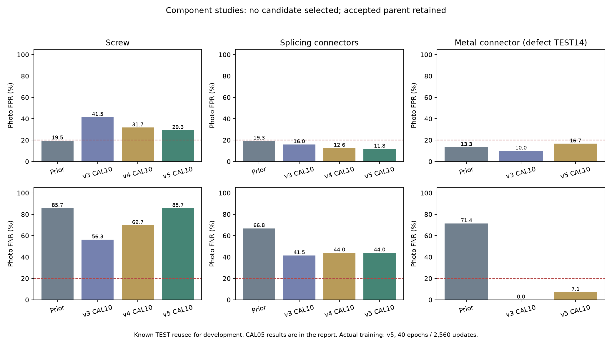

# 나사·연결부 보강: 실제 추가 학습과 후보 검증

기준일: 2026-10-14

## 이번 결론

**세 방식의 후보 모두 반영 조건을 충족하지 못해 기존 통과 모델을 유지했다.** 신규11유형 중 사진20% 이내4개, 그중15% 이내3개 상태가 그대로다. 역할4에게 새 모델 ZIP을 보내거나 기존 ZIP을 교체할 필요가 없다.

정상 참조(v3), 세부 특징/전체 배치 비교(v4), 실제 학습 판별기(v5)를 각각 사전에 조건을 기록하고 검증했다. 이번에는 v5에서 **실제40epoch·2,560번 optimizer 업데이트**를 수행했다. 단순 경고 기준 변경을 신경망 학습 횟수로 세지 않았다.

## 사용한 자료와 평가 범위

| 유형 | 정상FIT | 정상CAL | 정상 평가 | 결함 평가 |
|---|---:|---:|---:|---:|
| 나사 | 96 | 24 | 41 | 119 |
| 전선 연결부 | 330 | 54 | 119 | 193 |
| 금속 연결부 | 101 | 25 | 30 | 14 |

모두 앞서 확보한 공개 자료이며 새 독립 현장 사진·실제 고장 라벨을 추가한 작업은 아니다. 원래TEST 사진을 반복 사용해 개발 후보를 비교했다. 새 촬영 현장의 성능이나 물리적 부품·촬영장소가 독립된 성능이 검증된 것은 아니다.
금속 연결부는 결함 평가14장으로 사전 최소20장 조건에 부족하다. 오탐·미탐이 낮게 측정돼도 목표 통과로 승격하지 않았다.

## 모든 후보 결과

| 유형 | 방식 | 정상CAL 경고 예산 | 사진 오탐 | 사진 미탐 | 판정 |
|---|---|---:|---:|---:|---|
| 나사 | 현재 사용 모델 | 기존 기준 | 19.51% | 85.71% | 유지 |
| 나사 | 정상 지역 특징 | 10% | 17/41 = 41.46% | 67/119 = 56.30% | 오탐·미탐 조건 미달 |
| 나사 | 정상 지역 특징 | 5% | 11/41 = 26.83% | 78/119 = 65.55% | 오탐·미탐 조건 미달 |
| 나사 | 세부 특징/전체 배치 | 10% | 13/41 = 31.71% | 83/119 = 69.75% | 오탐·미탐 조건 미달 |
| 나사 | 세부 특징/전체 배치 | 5% | 5/41 = 12.20% | 94/119 = 78.99% | 오탐·미탐 조건 미달 |
| 나사 | 학습 판별기 | 10% | 12/41 = 29.27% | 102/119 = 85.71% | 오탐·미탐 조건 미달 |
| 나사 | 학습 판별기 | 5% | 2/41 = 4.88% | 115/119 = 96.64% | 오탐·미탐 조건 미달 |
| 전선 연결부 | 현재 사용 모델 | 기존 기준 | 19.33% | 66.84% | 유지 |
| 전선 연결부 | 정상 지역 특징 | 10% | 19/119 = 15.97% | 80/193 = 41.45% | 오탐·미탐 조건 미달 |
| 전선 연결부 | 정상 지역 특징 | 5% | 4/119 = 3.36% | 109/193 = 56.48% | 오탐·미탐 조건 미달 |
| 전선 연결부 | 세부 특징/전체 배치 | 10% | 15/119 = 12.61% | 85/193 = 44.04% | 오탐·미탐 조건 미달 |
| 전선 연결부 | 세부 특징/전체 배치 | 5% | 6/119 = 5.04% | 110/193 = 56.99% | 오탐·미탐 조건 미달 |
| 전선 연결부 | 학습 판별기 | 10% | 14/119 = 11.76% | 85/193 = 44.04% | 오탐·미탐 조건 미달 |
| 전선 연결부 | 학습 판별기 | 5% | 10/119 = 8.40% | 95/193 = 49.22% | 오탐·미탐 조건 미달 |
| 금속 연결부 | 현재 사용 모델 | 기존 기준 | 13.33% | 71.43% | 유지 |
| 금속 연결부 | 정상 지역 특징 | 10% | 3/30 = 10.00% | 0/14 = 0.00% | 평가 표본 부족 |
| 금속 연결부 | 정상 지역 특징 | 5% | 2/30 = 6.67% | 11/14 = 78.57% | 평가 표본 부족 |
| 금속 연결부 | 학습 판별기 | 10% | 5/30 = 16.67% | 1/14 = 7.14% | 평가 표본 부족 |
| 금속 연결부 | 학습 판별기 | 5% | 2/30 = 6.67% | 11/14 = 78.57% | 평가 표본 부족 |

CAL 예산은 정상 보정 자료의 순위 기준이며 실제 오탐률 보장치가 아니다. 모든 후보에서alpha.10/.05 두 기준을 평가 전에 고정했고, TEST 점수의 분위수로 임계값을 고르지 않았다. 후보 선택과 다음 회차 설계에는 이미 알려진 평가 결과가 사용되므로 이 표는 개발 비교 결과다.

## 실제 신경망 학습

- 기존 공통 MobileNet 분석부·시설/벨트/이물질/설비 출력·정상 케이블/너트 참조를 고정했다. 같은 모델에 유형 조건을 받는 판별기 하나를 추가했다.
- 정상FIT527장의134,912개 특징만 학습 자료로 사용했다. 매 업데이트마다 유형별256개, 합768개 정상 지역 특징을 뽑았다.
- 정상 특징은label0, 작은 Gaussian 변형을 주고 다시 정규화한 특징은label1로 학습했다. 가상 이상은 실제 고장 정답이 아니다.
- 정상 지역 특징1,966,080회와 같은 수의 가상 이상을 반복 학습했다. 반복draw를 새로운 사진으로 세지 않았다.
- 공유 판별기는조건embedding과1016→256→128→1 MLP다. AdamW·BCE·고정40epoch로 학습하고 마지막 회차만 평가했다. TEST·CAL로 학습하거나 TEST로 epoch를 선택하지 않았다.
- 첫epoch 평균학습BCE 0.6897 → 마지막 0.0262. 이는 정상/가상 변형 학습 손실이며 실제 고장 정확도가 아니다.
- optimizer state의step이모두2,560이고, 초기 판별기와 비교해7개tensor가모두변했다. 기존부모모델tensor와케이블/너트참조는정확히같다.

[SimpleNet 논문](https://arxiv.org/abs/2303.15140)의 정상 특징·Gaussian 가상 이상·판별기 아이디어를 참고했다. 논문의feature adapter·backbone·구조·학습 설정·성능을 재현한 구현은 아니다. [저자 코드](https://github.com/DonaldRR/SimpleNet)는 방식 확인용으로 읽었고 다운로드해 실행하지 않았다.

## 결함 종류별로 남은 문제

| 전선 연결부 후보(CAL10) | 구성·관계 이상 미탐 | 구조·외관 이상 미탐 |
|---|---:|---:|
| 정상 지역 특징 | 35/108 = 32.41% | 45/85 = 52.94% |
| 세부 특징/전체 배치 | 34/108 = 31.48% | 51/85 = 60.00% |
| 학습 판별기 | 40/108 = 37.04% | 45/85 = 52.94% |

지역 특징 비교와 전체 배치 비교는 서로 다른 결함에서 실패했다. 전체 배치 비교만으로 세밀한 외관 결함까지 해결되지 않았다. 가상 이상을 잘 구분하는 판별기도 실제 손상 전체에 충분히 일반화하지 못했다.
나사는 원본 해상도 보존과 실제 손상 학습자료를 다음 검증 대상으로 잡는다. 이번 결과만으로 원인을 해상도 하나로 확정하지 않는다.

## 다음 개발 순서

1. 원본 세부 정보를 유지하는 확대·타일 입력을 준비한다. 평가 정답을 보고 타일 위치를 고르지 않는다.
2. 실제 손상 사진이 학습에 포함되는 추가 자료를 확보하고, 중복·촬영그룹을 확인해 학습/보정/평가를 분리한다. 현재TEST 정답을 학습용으로 옮기지 않는다.
3. 새 판별기에 실제 손상 신호를 학습시키는 실험을 새 사전 조건으로 시작한다. 현재 통과한 네 유형의 결과를 함께 보존·검증한다.
4. 금속 연결부는 특히 새로운 결함 평가 표본을 확보한다. 표본을 확보하기 전까지평가 부족 상태를 유지한다.

## 기존 앱 연결과 보존

현재 역할4 전달물은기존케이블·너트ZIP이다. 이번회차는새전달ZIP·APK·기본앱모델을만들거나교체하지않았다. 새후보C++연결검사는0회이며, 이전ZIP의21개성공기록을이번회차검사로세지않았다.
자료·모델·기존보고서61,683개의SHA와mtime,기존Python소스510개의SHA를보존했다. 후보의기존위치heatmap과pixel기준도같다. 사진판별실험을위치정확도개선으로표시하지않았다.
각runs의selected/final.pt는후보선택과정의메타데이터사본이며,이번처럼선택항목이없으면활성모델이아니다. 아래활성SHA를기준으로이어간다.

현재 활성 연구 모델SHA: `bb30750a1a69146c08195e42fb7ea5dada74feaed37e554726216afa4b03b92e`
현재 역할4 ZIP SHA: `416b0845554344f9707f391ae0c232434eec602d15072ccf562e376443bf5722`

- [v3 정상 참조 조건](equipment-component-reference-v3-protocol.json)
- [v3 전체 결과](equipment-component-reference-v3-validation.json)
- [v4 세부/배치 조건](equipment-component-detail-v4-protocol.json)
- [v4 전체 결과](equipment-component-detail-v4-validation.json)
- [v5 실제 학습 조건](equipment-component-discriminator-v5-protocol.json)
- [v5 전체 결과](equipment-component-discriminator-v5-validation.json)
- [v5 보존 검증](equipment-component-discriminator-v5-verification.json)
- [최종 감사](equipment-component-rounds-v3-v5-final-audit.json)
- [현재 역할4 연결 안내](../../docs/EQUIPMENT_REFERENCE_HANDOFF_KO.md)
- [자료 출처·연구 사용 조건](EQUIPMENT_EXPANSION_ATTRIBUTION_KO.md)
