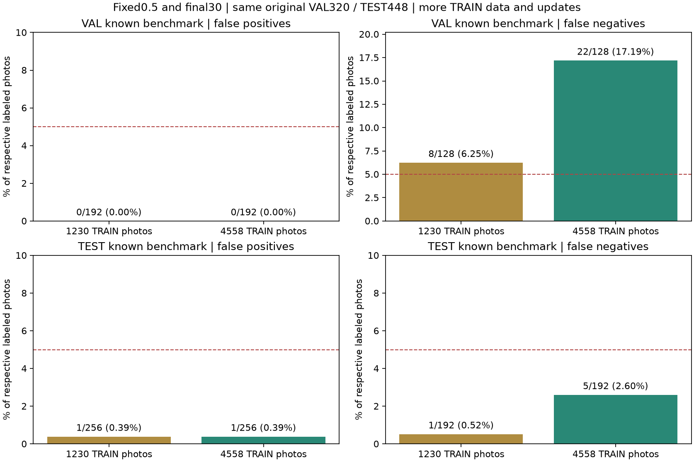
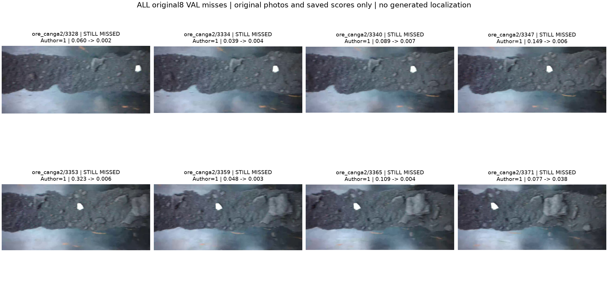

# 이물질 학습 사진 보강 결과 · 2026-10-12

## 보강한 내용

이전 모델이 VAL의 `canga2`8장을 놓친 문제를 보고, **다른 TRAIN 촬영 구간의 원본 사진**을 추가했다.
미탐 사진이나 같은 VAL/TEST 촬영 구간을 학습에 넣지 않았다.
학습은1,230장(정상718/이물질512)에서 **4,558장(정상3,067/이물질1,491)**으로 증가했다.
추가 TRAIN3,328장과 같은 VAL 촬영명의 미사용309장(정상192/이물질117)을 준비했다.
기존1,998장 전체의 원본 JPEG·384 전처리 PNG는 동일 바이트로 유지했다.
기존 VAL320장·TEST448장의 사진·정답·분모를 바꾸지 않았다.

새 자료를 웹에서 다시 받을 필요 없이 작성자 전체 SHA가 검증된 원본 ZIP에서 선별했다.
TRAIN 촬영명/클래스마다 최대256개의 수치 순서 프레임을 일정 간격으로 뽑고 이전64개 프레임을 합쳤다.
해독RGB 완전 중복0, 촬영명 그룹 분리, sourceTEST의 TRAIN 유입0을 확인했다.
추가 VAL은 기존 평가 사진을 제외하고 촬영명/클래스마다 최대64개를 점수 계산 전에 선택했다.
정답은 작성자 폴더의 사진 단위 이물질 유무이며 AI/사람이 새 라벨을 만들지 않았다.

## 실제 학습과 공정한 비교 범위

ResNet18·입력384·batch32·seed95·임계값0.5·밝기/좌우 변형·AdamW·30epoch는 이전과 같다.
일반 ImageNet과 새 분류 헤드에서 시작했고 **초기 가중치 SHA가 이전 모델과 같음**을 검증했다.
이전 이물질 모델을 이어 학습하거나 건물/벨트 균열 모델을 사용하지 않았다.
클래스 가중치는 새 TRAIN의 정상/이물질 비율을 따른다.

실제 **30epoch·19.63분·4,290회 업데이트**를 완료했다.
이전 모델은30epoch·1,170회였으므로 **사진 수와 업데이트 수가 함께 증가**했다.
동일 계산량에서 데이터만의 효과를 분리한 실험은 아니다. 사전 GPU 시험1회는 epoch에서 제외했다.
설정·입력·소스를 학습 전 커밋 `4bd69c5`으로 고정했고,
마지막30epoch와0.5 기준을 새 점수 계산 전에 저장했다. 점수로 epoch나 임계값을 고르지 않았다.

기존 VAL/TEST 결과를 본 뒤 보강했으므로 아래 기존 사진 결과는 **재사용하는 공개 비교 벤치마크**다.
새로운 독립 최종 시험 성능으로 소개하지 않는다. 추가309장도 처음 점수를 계산한 사진이지만 같은3 VAL 촬영명에 속한다.
독립 공장·다른 카메라·새 물리적 물체 검증은 아니다. 연속 프레임 간 상관은 남아 있다.

## 사진 오탐·미탐

| 자료 | 이전 오탐 | 보강 오탐 | 이전 미탐 | 보강 미탐 |
|---|---:|---:|---:|---:|
| 같은 VAL320장 | 0/192 · 0.00% | **0/192 · 0.00%** | 8/128 · 6.25% | **22/128 · 17.19%** |
| 같은 TEST448장 · 알려진 비교 자료 | 1/256 · 0.39% | **1/256 · 0.39%** | 1/192 · 0.52% | **5/192 · 2.60%** |
| 추가 VAL309장 · 같은 촬영명 | 이번 이전 모델은 미측정 | **0/192 · 0.00%** | 이번 이전 모델은 미측정 | **17/117 · 14.53%** |

학습 전에 정한 공통 VAL 기준(오탐 악화 없음·미탐 감소)은 **미달**이다.
추가 VAL의 오탐/미탐 각각5% 미만 기준은 **미달**이다.
VAL에서 이전 오류0건을 바로잡았고 새 오류14건이 생겼다.
기존 모델과 파일을 보존했으며 앱 기본 모델은 자동 교체하지 않았다.

### 모든 촬영명별 분모

| 자료 | 촬영명 | 오탐 | 미탐 |
|---|---|---:|---:|
| val | ore_2 | 0/64 · 0.00% | 0/0 · 산정 불가 |
| val | ore_canga2 | 0/64 · 0.00% | 9/64 · 14.06% |
| val | ore_jaspilito_3 | 0/64 · 0.00% | 13/64 · 20.31% |
| audit_val | ore_2 | 0/64 · 0.00% | 0/0 · 산정 불가 |
| audit_val | ore_canga2 | 0/64 · 0.00% | 8/64 · 12.50% |
| audit_val | ore_jaspilito_3 | 0/64 · 0.00% | 9/53 · 16.98% |
| test | ore | 1/64 · 1.56% | 0/0 · 산정 불가 |
| test | ore_7_wood_2 | 0/64 · 0.00% | 0/64 · 0.00% |
| test | ore_7_wood_3 | 0/64 · 0.00% | 5/64 · 7.81% |
| test | ore_canga | 0/64 · 0.00% | 0/64 · 0.00% |

### 이전 미탐8장 전체

아래8장은 평가 자료로 보존된 동일 원본이다. 저장된 점수만 비교했고 손상 위치·이물질 경계 상자를 생성하지 않았다.
좋아진 사진만 선택하거나 남은 오류의 라벨을 수정하지 않았다.

## 앱 연결과 한계

기존 이물질 서버를 새 체크포인트와 해당 SHA로 명시적으로 실행할 수 있다.
요청/응답은 `conveyor_foreign_object`, `iron_ore_closeup`, 사진 유무 분류, 사람 최종 확인으로 유지한다.
정상은 이물질 없음이고 정상 벨트·정상 가동·기계 고장 없음이 아니다.
이물질 위치 정답이 없어 heatmap/경계 상자는 없다. 벨트 균열 모델의 오차와 이 결과를 합치지 않는다.
이 데이터는 철광석이 흐르는 실험 컨베이어의 **잘린 벨트 근접 사진**이다.
새 현장/운반물/스마트폰 전체 장면 성능은 별도 검증이 필요하다.

- 새 가중치: `runs/conveyor-foreign-expansion-v2/final.pt`
- SHA256: `16f7436e76785a18eca151592ee523657daf07895a2d64900b6ecc0ee3cecb5e`
- [고정 설정](conveyor-foreign-expansion-protocol.json)
- [실제 학습](conveyor-foreign-expansion-training.json)
- [전체 수치·바로잡은 오류·새 오류](conveyor-foreign-expansion-results.json)
- [실제 학습·보존 확인](conveyor-foreign-expansion-verification.json)
- [남은 오류 피드백 목록](conveyor-foreign-expansion-feedback.json)
- [역할4 전달 설명](../../docs/CONVEYOR_EXPANSION_HANDOFF_KO.md)
- [사진 출처·파생 그림 변경](CONVEYOR_EXPANSION_ATTRIBUTION_KO.md)

검증에서 이전 소스377개,
기존 모델/원본13,883개,
새 입력11,272개의 SHA·크기·수정시간을 확인했다.
데이터 검사4개와 실제GPU 업데이트/strict CPU·GPU 재로드를 통과했다.
후속 보강에서는 원래 알려진 TEST를 독립 성능이라고 재사용하지 않고 새 촬영/현장 정답을 확보한다.
