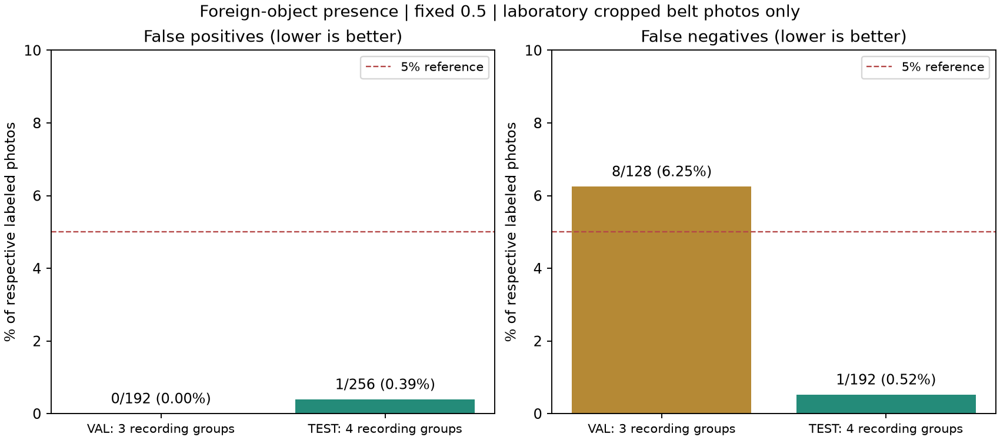
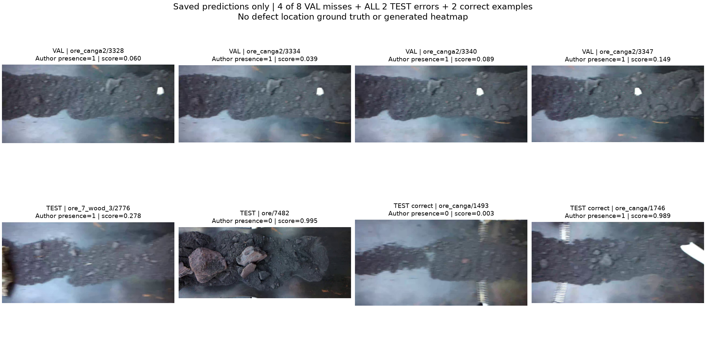

# 컨베이어 이물질 모델 실제 학습 결과 · 2026-10-12

## 앱에서 제공하는 기능

철광석이 흐르는 컨베이어의 근접 사진에서 **이물질이 보이는지**를 분류한다.
클래스는 `conveyor_foreign_object`이며, 기존 `belt_crack` 균열 위치 모델과 별개다.
점검자는 이물질 의심 결과를 채택·수정·거절하고 제거·재점검 내용을 남긴다.
위치 정답이 없는 분류 모델이라 이물질 경계 상자나 손상 heatmap은 제공하지 않는다.
‘이물질 미검출’은 균열 없음·정상 가동·안전 가동의 판정이 아니다.

## 실제 데이터와 분리

- 공개 원본: [Mendeley V1, DOI10.17632/s25x2bnshz.1](https://data.mendeley.com/datasets/s25x2bnshz/1), CC BY4.0.
- 원본 ZIP6,228,464,374바이트, 작성자 전체 SHA256 검증 완료. 원본69,636항목을 고유 학습 사진69,636장으로 계산하지 않았다.
- 작성자의 선별 사진18,933장 중 촬영명·클래스마다 최대64프레임을 숫자 순서로 일정 간격 선택했다. 모델 점수를 보기 전에 선택·분리를 고정했다.
- 실제 사용1,998장: TRAIN1,230장(이물질 없음718/있음512), VAL320장(192/128), TEST448장(256/192).
- 촬영명 그룹은 TRAIN12/VAL3/TEST4로 서로 분리했다. 기존 작성자 정상 TRAIN/TEST에서는19개 촬영명이 겹쳤으므로 그 프레임 분리를 그대로 사용하지 않았다.
- 사전 사진 확인에 사용한 `jaspilito` 촬영명은 TRAIN에만 배치했다. `_fastandfurious` 이름은 대응 원본 영상명으로 합쳤고, 다른 실제 설비라는 가정은 하지 않았다.
- 원본프레임 키가 중복된2개 행은 제외했다. 선별1,998장의 해독RGB 완전 중복은0이다. 영상 내 인접·유사 프레임은 남아 있다.
- 작성자 TEST 정상 사진256장은 품질·중복 검사와 최종 시험에만 사용했다. TRAIN/VAL·모델 선택에는 넣지 않았다.
- **원본은 벨트 영역이 잘린 사진**이다. 현장 스마트폰의 전체 장면이나 다른 운반물·카메라에 대한 성능은 검증하지 않았다.
- 라벨은 작성자의 `normal-op`/`anomaly` 폴더를 따른다. AI나 점검자가 새로 정답을 만들지 않았다. YOLO의 `conveyor` 영역 상자는 이물질 정답으로 사용하지 않았다.

## 실제 학습

ImageNet ResNet18과 새 단일 분류 출력으로 모델 전체를 학습했다.
입력384 letterbox, seed95, batch32, AdamW0.0001·weight decay0.0001,
TRAIN에서만 좌우 뒤집기·밝기 변형, TRAIN 비율 기반 가중 BCE를 사용했다.
**실제30epoch·2.69분·1,170회 업데이트**다.
사전 동작 시험1회 업데이트는 학습 epoch에 포함하지 않았다.

학습 전 설정·소스·입력 해시를 커밋 `8a1b787`에 고정했다.
마지막30epoch 모델과 임계값0.5를 시험 전에 고정했으며,
VAL/TEST 점수로 체크포인트를 선택하거나 임계값을 바꾸지 않았다.
TEST는 한 차례 점수를 계산했다. 아래 그림은 저장된 결과만 읽으며 모델을 다시 시험하지 않는다.

## 오탐·미탐

| 자료 | 이물질 없는 사진의 오탐 | 이물질 있는 사진의 미탐 |
|---|---:|---:|
| VAL · 3촬영명 | 0/192 · **0.00%** | 8/128 · **6.25%** |
| TEST · 4촬영명 | 1/256 · **0.39%** | 1/192 · **0.52%** |

TEST 사진 기준 두 비율은5% 미만이다. **VAL 미탐은6.25%이고 모든 조건5% 미만 기준은 미달**이다.
기존 벨트 균열·회로기판의 오차가 이 수치만큼 개선된 것은 아니다.
처음 학습한 이물질 모델이어서 동일 과제의 이전 모델 대비 개선율은 없다.
AUROC는 VAL0.999919/TEST0.999186이며,
높은 순위 성능만으로 고정 임계값의 누락 문제가 해결됐다고 해석하지 않는다.

### 촬영명별 분모

| 자료 | 촬영명 | 오탐 | 미탐 |
|---|---|---:|---:|
| VAL | ore_2 | 0/64 (0.00%) | - |
| VAL | ore_canga2 | 0/64 (0.00%) | 8/64 (12.50%) |
| VAL | ore_jaspilito_3 | 0/64 (0.00%) | 0/64 (0.00%) |
| TEST | ore | 1/64 (1.56%) | - |
| TEST | ore_7_wood_2 | 0/64 (0.00%) | 0/64 (0.00%) |
| TEST | ore_7_wood_3 | 0/64 (0.00%) | 1/64 (1.56%) |
| TEST | ore_canga | 0/64 (0.00%) | 0/64 (0.00%) |

VAL 누락8장은 모두 `canga2`의 연속 구간3328~3371에서 발생했다. 이 촬영명의 미탐은8/64=12.50%다.
TEST 오류도 모두 그대로 기록했다. 오탐1장과 미탐1장을 삭제하거나 정답을 다시 붙이지 않았다.
같은 영상의 연속 사진은 통계적으로 독립인 시행이라고 보기 어렵다.
JSON의 사진별 Wilson 구간은 독립 프레임 가정의 참고 계산이며, 독립 공장 신뢰구간이 아니다.
같은 물체의 재등장·실제 설비의 독립성·여러 공장 성능은 확인하지 않았다.

## 연결·보존 검증

학습 전후 기존 소스365개,
기존 모델·자료9,832개,
새 입력4,003개의 SHA·크기·수정시간 보존을 확인했다.
학습 관련 테스트4개, API 테스트5개, 실제 GPU 업데이트와 strict CPU/GPU 재로드를 통과했다.
실제 localhost HTTP에서 TRAIN 사진2장을 CPU로 분석했고 응답·원본 사진 SHA·모델 SHA·범위 필드를 확인했다.
API 점검 사진은 별도 시험 성능으로 합치지 않았다. 서버는 점검 후 종료했다.

- 가중치: `runs/conveyor-foreign-grouped-v1/final.pt`
- SHA256: `9d646df61e488bd90d6f00aeaba8bd67c184f9470526139636f335443d1825fe`
- [역할4·역할2 연결 설명](../../docs/CONVEYOR_FOREIGN_API_HANDOFF_KO.md)
- [학습 전 설정](conveyor-foreign-grouped-protocol.json)
- [전체 실제 수치](conveyor-foreign-grouped-results.json)
- [보존·실제 학습 확인](conveyor-foreign-grouped-verification.json)
- [실제 HTTP 확인](conveyor-foreign-grouped-api-smoke.json)
- [사진 출처·변경 설명](CONVEYOR_FOREIGN_ATTRIBUTION_KO.md)

## 다음 보강 우선순위

1. VAL의 `canga2` 누락 구간을 피드백 목록으로 보존하고, 비슷한 모양·배경을 포함한 **다른 영상의** 학습 정답을 확보한다.
2. 원본을 추가 선별한다면 학습 그룹에만 추가하고, 같은 오류 사진을 학습·시험에 동시에 넣지 않는다.
3. 기존 TEST는 이번 결과를 보존한다. 후속 모델 비교는 공개 고정 벤치마크로 명시하고 새 공장/촬영 구간을 최종 확인 자료로 추가한다.
4. 역할4는 근접 촬영·자르기 안내와 이물질 유무 화면을 연결한다. 이물질의 정확한 위치 표시는 위치 주석 자료를 확보한 별도 과제로 둔다.
5. 기존 벨트 균열의 정상 사진 오탐 검증과 작은 균열 위치 보강도 별도 모델에서 진행한다.

재현: `scripts/study_conveyor_foreign.py`의 preflight → freeze → 설정 커밋 → train → evaluate → verify 순서다.
이미 완성된 실행 폴더를 덮어쓰는 재학습은 거절하도록 구현했다. 새 실험은 새 이름·설정·실행 폴더로 만든다.
