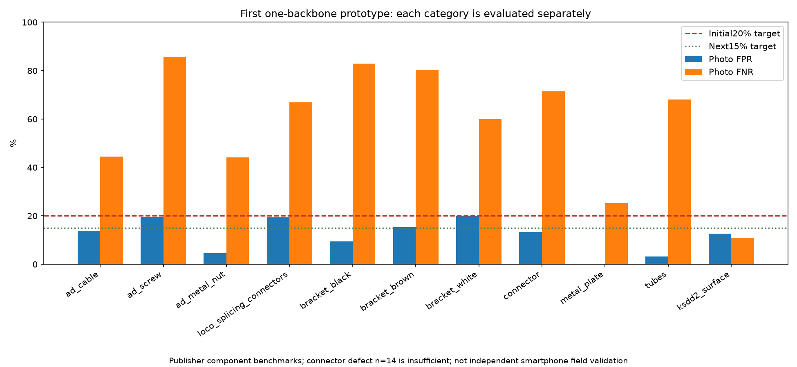

# 산업 설비 범위 확장 · 첫 통합 학습과 앱 연결 틀

기준일: 2026-10-14

## 이번 목표와 완료 범위

점검 항목별 **사진 오탐·미탐을 각각20% 이하로 만들고, 다음15% 이하로 개선**한다. 전체 평균으로 어려운 설비를 가리지 않는다. 정상/결함 평가 사진이 각각20장 미만이거나 정답이 없는 항목은 평가 부족으로 표시한다. 위치 미탐·IoU는 사진 유무와 따로 기록한다.

- 새 자료4종과 설비11유형의 다운로드·정답 검수·학습/기준설정/평가 분리를 완료했다.
- 기존 모델의 MobileNet 공통 분석부 하나에 설비 유형을 받는 외관 분석부 하나를 추가했다. 시설·벨트·이물질의 기존 가중치와BN통계를 모두 고정했다. 서로 다른11개 신경망을 배포하는 구조가 아니다.
- 실제30epoch·2,640 optimizer 업데이트. 정상 학습3,056장, 기준설정용 정상858장, 평가2,199장이다. 정상TRAIN42,240draw는 반복 샘플링 횟수이고 새 사진 수가 아니다.
- 저자가 제공한 결함TRAIN246장은 추후 지도학습용으로 보관했다. 이 첫 방식은 정상 외관 특징을 복원하도록 학습하고 복원 차이를 이상 점수로 사용한다.
- 앱의 사진 분석·조치 전후 비교·보고서 요약 요청을 지원하는CPU API를 추가했다. 기존 C++ 어댑터에서 새 유형 ID를 점검 항목으로 전달할 수 있게 했다.
- 이번 모델은 전체 틀 연결용 연구 시제품이다. 기존 선택 모델·앱 기본값·기존 전달 ZIP은 자동 교체하지 않았다.

## 새 자료의 실제 사용 범위

| 자료 | 이번 대상 | 사진 수 | 정상FIT | 정상CAL | TEST |
|---|---|---:|---:|---:|---:|
| mvtec_ad | cable, screw, metal_nut | 1189 | 450 | 113 | 425 |
| mvtec_loco | splicing_connectors | 732 | 330 | 54 | 312 |
| kolektor_sdd2 | surface | 3335 | 1668 | 417 | 1004 |
| mpdd | bracket_black, bracket_brown, bracket_white, connector, metal_plate, tubes | 1346 | 608 | 174 | 458 |

합계6,602장. TEST와canonical pHash거리2이하로 비슷한343장은FIT/CAL에서 제외했다. RGB정확중복이FIT/CAL/TEST를 넘나들지 않도록 확인했다. 물리적 부품·촬영장소의 원래 그룹ID를 검증한 자료는 아니므로 독립 현장 성능으로 해석하지 않는다.

미러에 포함된 정답 표시 이미지·설명문·crop·실행 파일은 학습에 넣지 않았다. 실제 이미지와 저자 mask만 사용했다. MVTec AD는공식로더의압축파일SHA와일치한다. LOCO·MPDD·Kolektor는고정연구미러를사용했고미러체크섬/파일해시와출처를기록했다. 원저자 제공checksum으로 모두검증했다는뜻은 아니다.

## 첫 사진 단위 성능

| 설비 | 정상TEST | 결함TEST | 오탐 | 미탐 | 단계 |
|---|---:|---:|---:|---:|---|
| 케이블 | 58 | 92 | 13.79% | 44.57% | 보강 필요 |
| 나사 | 41 | 119 | 19.51% | 85.71% | 보강 필요 |
| 너트 | 22 | 93 | 4.55% | 44.09% | 보강 필요 |
| 전선 연결부 | 119 | 193 | 19.33% | 66.84% | 보강 필요 |
| 검정 브래킷 | 32 | 47 | 9.38% | 82.98% | 보강 필요 |
| 갈색 브래킷 | 26 | 51 | 15.38% | 80.39% | 보강 필요 |
| 흰색 브래킷 | 30 | 30 | 20.00% | 60.00% | 보강 필요 |
| 금속 연결부 | 30 | 14 | 13.33% | 71.43% | 평가 표본 부족 |
| 금속판 | 26 | 71 | 0.00% | 25.35% | 보강 필요 |
| 금속 튜브 | 32 | 69 | 3.12% | 68.12% | 보강 필요 |
| 부품 표면 | 894 | 110 | 12.64% | 10.91% | 15% 목표 통과 |

첫 결과에서20%기준을 만족하고 평가 표본도 충분한 유형은 **1/11개**다. 부품 표면. 나머지 유형이 같은 수준이라고 주장하지 않는다.
이상 기준은 각유형 정상CAL의85%순서통계로 미리 정한 방식이며 결함TEST를 보고 임계값을 낮추지 않았다. 정상CAL에서의 목표값이 실제TEST오탐을 보장하지 않는다. 사진 이상 후보와 확정 고장 원인은 구분한다.

## 위치 성능 · 별도 측정

| 설비 | 위치 IoU | 손상pixel 미탐 | 256축소로 mask사라짐 |
|---|---:|---:|---:|
| 케이블 | 15.64% | 76.03% | 0 |
| 나사 | 0.57% | 97.20% | 0 |
| 너트 | 11.98% | 87.50% | 0 |
| 전선 연결부 | 9.74% | 89.42% | 0 |
| 검정 브래킷 | 1.17% | 89.16% | 0 |
| 갈색 브래킷 | 2.65% | 93.59% | 0 |
| 흰색 브래킷 | 0.68% | 83.14% | 0 |
| 금속 연결부 | 1.58% | 96.78% | 0 |
| 금속판 | 58.68% | 27.96% | 0 |
| 금속 튜브 | 4.84% | 90.41% | 0 |
| 부품 표면 | 23.26% | 16.95% | 0 |

새 heatmap은16×16공통 특징의 차이를256으로 확대한 거친 확인 자료다. 정밀한 결함 segmentation이나 사진으로 확인되지 않는 내부 모터·베어링 고장 진단을 학습한 것이 아니다.

## 기존 항목의 현재 상태

| 항목 | 현재 상태 | 다음 보강 |
|---|---|---|
| 벨트 | 사진미탐 0.57%; 정상전체사진오탐 미측정; pixel미탐 32.96% | 정상전체사진과 작은손상 위치 |
| 시설 균열·박락 | 알려진출처별 최악률 25.13% | 20%넘는 출처·항목부터 |
| 컨베이어 이물질 | 알려진783장 오탐 1.50%·미탐 0.26% | 촬영환경 다양화 |
| PCB | 이전 별도연구모델과연결이력 보유; 이번공통모델에포함하지않음 | 후속통합·유형별검증 |

기존 항목은이번회차의새평가가아니고기존측정값을계승한다. 기존tensor와CPU출력정확일치를검사했다. 전체산업현장/모든설비가20%안에든상태는아니다.

## 이후 순서

1. 역할4는시제품CPU API에설비선택·사진입력·후보검토·조치전후·보고서를연결한다. 성능부족항목도개발틀은있지만연구시제품상태를유지한다.
2. 기존벨트의정상전체사진검증과작은손상위치를병행한다. 분모가없는오탐을0%로채우지않는다.
3. 새설비는부품표면의통과상태를보존하면서금속판부터미탐20%이하를목표로보강한다. 다음케이블·너트로확장한다.
4. 정상만복원하는첫방식에서미탐이큰유형은정상참조특징비교와저자TRAIN결함을사용한지도학습방식을새사전조건으로비교한다. 임계값만TEST에맞추지않는다.
5. 새학습은별도run과학습전조건고정·commit을사용한다. 알려진TEST를반복비교한이후성능은새현장검증으로부르지않는다.

## 학습·복구·보존 기록

- 실제2640업데이트완료후Kolektor 정상CALpixel배열27,328,512개의torch.quantile입력제한에걸렸다. 마지막가중치·optimizer·scheduler·RNG는progress에저장되어있었다.
- 같은선형0.995분위수정의를NumPy로계산하여복구했다. 작은배열에서torch와동일정의및2^24초과배열검사2개를통과했다. CPU/GPU tensor비교도CPU로맞춰마무리했다. 복구에추가optimizer호출은0회다.
- 기존/새입력61,073개의SHA·mtime와기존Python소스476개를보존했다. final과progress의모든tensor가같다.
- 데이터·학습검사8개와대용량분위수검사2개가통과했다. 학습검사중폐기한소형optimizer업데이트3회는실제학습2640회와분리한다.
- 모든기존tensor·기존3기능CPU출력정확일치,기존3기능과새설비의CPU/GPU수치일치를확인했다. 실제CPU API·C++연결검증은별도release기록을확인한다.

학습모델SHA: `c7e5b5d5f0d30473211dedf3b1d15624501a0110826d0e17db60913ed4f7a3bc`

- [정답·분리 검수](equipment-expansion-v1-data-audit.json)
- [학습 전 조건](equipment-expansion-v1-protocol.json)
- [실제 학습](equipment-expansion-v1-training.json)
- [실제 평가·사진별 점수](equipment-expansion-v1-results.json)
- [기존 항목·단계 목표](equipment-expansion-v1-scope-gates.json)
- [보존 검증](equipment-expansion-v1-verification.json)
- [기준 계산 복구](equipment-expansion-v1-calibration-repair-v2.json)
- [자료 출처·사용 조건](EQUIPMENT_EXPANSION_ATTRIBUTION_KO.md)
- [역할4 연결 가이드](../../docs/EQUIPMENT_EXPANSION_HANDOFF_KO.md)
