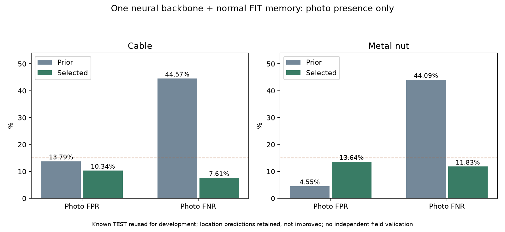

# 케이블·너트 사진 판별 보강

기준일: 2026-10-14

## 선택 결과

기존 공통 AI 분석부 하나에서 정상 부품의 특징을 저장하고 새 사진과 비교하도록 확장했다. 정상 케이블178장·너트176장, 총354장의90,624개 지역 특징을 하나의 모델 파일에 추가했다. 별도 신경망을 결합하거나 새 사진을 다운로드한 작업은 아니다.

| 유형 | 기존 사진 오탐 | 이번 사진 오탐 | 기존 사진 미탐 | 이번 사진 미탐 | 알려진 평가 사진 |
|---|---:|---:|---:|---:|---|
| 케이블 | 13.79% | 6/58 = 10.34% | 44.57% | 7/92 = 7.61% | 정상58·결함92 |
| 너트 | 4.55% | 3/22 = 13.64% | 44.09% | 11/93 = 11.83% | 정상22·결함93 |

두 유형 모두 사진 단위 오탐·미탐15% 조건을 충족했다. 금속판20%와 부품 표면15% 상태를 유지하여 신규11유형 중4개가20% 이내이며, 그중3개가15% 이내다. 나머지7유형은 보강 필요/평가 부족 상태다.

**같은 공개 평가 사진으로 반복 비교한 개발 결과다.** 첫 실패를 확인한 뒤 보수적인 두 정상 기준을 추가로 정했으므로 후보 선택에는 알려진TEST가 사용됐다. 새로운 산업현장에 대한 독립 성능, 학습 자료와 물리적 부품·촬영 장소가 분리된 성능을 검증한 것은 아니다. 특히 너트 정상 평가 사진은22장으로 작다.

## 어떻게 바꿨는가

1. 기존 신경망·공통 MobileNet 분석부·재구성 출력의 모든 tensor를 유지했다. 앞선 전체 틀의30epoch·2,640회 신경망 학습은 그대로이며, **이번 추가 경사하강/optimizer 업데이트는0회**다.
2. 정상FIT만 공통 분석부에 통과시켰다. low40/high960 특징을 각각 정규화하고3×3 지역 평균을 적용한16×16 격자를 저장한다. 케이블45,568개·너트45,056개 특징을 FP16 버퍼로 저장하고 최근접 cosine 비교는FP32로 계산한다. 표본 추출이나 coreset 탐색은 없다.
3. 입력 사진은 기존과 같은 RGB256 정사각형·ImageNet 정규화다. 공통 분석부를 사진당 한 번 실행하여 사진 판별용 정상 참조 거리와 기존 위치 표시를 각각 계산한다. 사진 점수는 참조 거리 상위1% 평균이다.
4. 정상CAL 케이블45장·너트44장만으로 경고 기준을 정했다. 선택한 케이블은rank44·alpha.05, 너트는rank41·alpha.10이다. alpha는 정상CAL 기준을 정하는 비율이며 실제 오탐률이나 달성 보장치가 아니다.
5. 평가 결함 사진을 학습에 넣거나 TEST 점수의 분위수로 기준을 고르지 않았다. 각 회차의 후보와 선택 조건을 Git에 먼저 기록한 뒤 평가했다. 다만 회차 간 설계는 이미 본 TEST 결과에 영향을 받은 개발 과정이다.

[PatchCore 원 논문](https://arxiv.org/abs/2106.08265)의 정상 지역 특징 비교 아이디어를 참고했다. 논문의 모델·coreset·설정을 그대로 재현한 구현이라고 주장하지 않는다.

## 실패 후보를 포함한 비교

| 후보 | 케이블 오탐 | 케이블 미탐 | 너트 오탐 | 너트 미탐 | 선택 |
|---|---:|---:|---:|---:|---|
| 기존 재구성 | 13.79% | 44.57% | 4.55% | 44.09% | 기준 |
| 재구성 CAL20 | 22.41% | 38.04% | 13.64% | 35.48% | 모두 제외 |
| 정상 참조 CAL20 | 39.66% | 2.17% | 27.27% | 7.53% | 오탐 초과로 모두 제외 |
| 정상 참조 CAL10 | 24.14% | 3.26% | 13.64% | 11.83% | 너트 |
| 정상 참조 CAL05 | 10.34% | 7.61% | 0.00% | 35.48% | 케이블 |

v1에서는 재구성 CAL20·정상 참조 CAL20 두 후보를 고정했다. 두 후보 모두 사진 오탐·미탐20% 조건을 함께 만족하지 못해 제외했다. 그 뒤 v2에서 정상 참조 CAL10·CAL05만 사전에 고정해 비교했다. 이 두 후보 외의 연속 임계값 탐색은 하지 않았다.

## 손상 위치는 별도로 봐야 한다

| 유형 | 기존·이번 위치 IoU | 기존·이번 손상pixel 미탐 |
|---|---:|---:|
| 케이블 | 15.64% | 76.03% |
| 너트 | 11.98% | 87.50% |

위 표는 원래의 재구성 heatmap/pixel 기준 결과이며 이번에도 동일하다. 위치 정확도는 아직 낮다. **사진 판별15% 통과가 손상 위치 미탐15% 통과를 뜻하지 않는다.**
API의heatmapPngBase64는 기존 위치 표시, referenceHeatmapPngBase64는 사진 판별에 쓰인 정상 참조 차이의 시각화다. 두 출력을 구분한다. 참조 차이 이미지는 위치 정답으로 평가한 분할 결과가 아니므로 확정 고장 영역으로 표시하지 않는다.

## 앱 연결과 보존

기존 자료·모델·보고서61,469개의 SHA/mtime과 기존 Python 소스497개의 SHA를 보존했다. 선택한 모델의 기존 신경망 tensor는 모두 같고, 다른9유형의 경고 기준과 위치 출력을 보존했다. v1에서 케이블·너트의 모든 알려진TEST 위치 예측을 원래 결과와 직접 대조했다.
한 모델 파일·한 공통 분석부를 유지하며 기존3항목과 신규11유형의 C++ 요청을 지원한다. 기존 앱 기본값을 자동 배포한 것은 아니며 새 연구 전달물을 명시적으로 선택해서 연결한다. 연결 검사 기록은 release JSON을 확인한다.
사진으로 내부 모터·베어링의 작동 고장을 확정하지 않는다. mechanicalFailureState는not_assessed이고, 위험 등급·조치 문장·보고서 요약은 규칙 템플릿이다. 최종 확인은 점검자가 수행한다.

## 다음 우선순위

전체 범위를 먼저 보강한다는 순서에 따라 다음은 **나사·연결부**의 사진 미탐을 줄이는 작업이다. 케이블·너트의 위치 표시 보강과 새로운 현장 사진 평가는 별도 과제로 남긴다.

선택 모델 SHA: `bb30750a1a69146c08195e42fb7ea5dada74feaed37e554726216afa4b03b92e`

- [v1 사전 조건](equipment-reference-photo-v1-protocol.json)
- [v1 제외 결과](equipment-reference-photo-v1-selection.json)
- [v2 사전 조건](equipment-reference-budget-v2-protocol.json)
- [v2 선택 결과](equipment-reference-budget-v2-selection.json)
- [v2 CAL10 검증](equipment-reference-budget-v2-normalCAL10-validation.json)
- [v2 CAL05 검증](equipment-reference-budget-v2-normalCAL05-validation.json)
- [보존 검증](equipment-reference-budget-v2-verification.json)
- [원래11유형 성능](EQUIPMENT_EXPANSION_RESULTS_KO.md)
- [출처·사용 조건](EQUIPMENT_EXPANSION_ATTRIBUTION_KO.md)
- [역할4 연결](../../docs/EQUIPMENT_REFERENCE_HANDOFF_KO.md)
