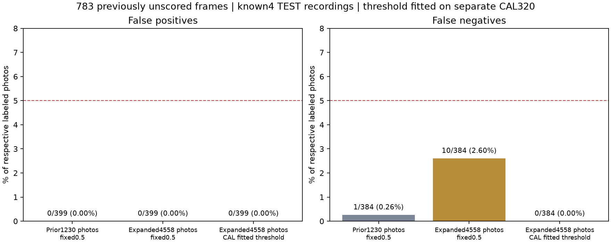

# 이물질 검출 기준 보정 결과 · 2026-10-12

## 이번에 실제로 한 작업

1. TRAIN 사진을1,230→4,558장으로 늘려 **실제30epoch·19.63분·4,290회 업데이트** 학습했다.
2. 같은 기존 VAL320장의 미탐이6.25%→17.19%로 악화됐다. 이 실패를 [원래 결과](CONVEYOR_FOREIGN_EXPANSION_RESULTS_KO.md)에 그대로 남겼다.
3. VAL에서 정상/이물질 점수 순위는 분리돼 있어, 이320장을 명시적으로 **CAL 보정 자료**로 지정하고 검출 기준을 계산했다.
4. 원본 신경망 가중치는 그대로 유지했다. **보정 단계의 추가 신경망 학습은0epoch·0업데이트**다. 학습했다고 말하는30epoch는 앞선 실제 학습 기록이다.
5. 새 검출 기준 `0.0014614396534601965`를 기록한 체크포인트를 저장한 뒤, 아직 점수를 계산하지 않은783장으로 한 차례 비교했다.

## 기준을 정한 방법

보정용320장(정상192/이물질128)의 점수 후보에서 오탐률/미탐률 중 큰 값이 최소가 되는 기준을 선택했다.
동률은 두 비율의 합,0.5와의 거리 순으로 정했다. 후보는 서로 다른 점수의 logit 중간값이다.
알고리즘·소스·보정 자료·추가 사진은 기준 계산 전에 커밋 `5e029c3`에 고정했다.
추가783장의 점수나 정답, 기존 TEST448장의 점수/정답을 기준 계산에 넣지 않았다.
다만 이전 공개 시험 결과가 알려져 있었고, 보정 실험 자체는 이전 VAL 실패를 보고 시작했다.

CAL에서 오탐/미탐이0으로 나오는 것은 **기준을 맞춘 자료에 대한 결과**이며 독립 성능 검증으로 계산하지 않는다.
기준이0.5보다 낮다고 사진의 고장 확률이 낮아진 것은 아니다. 원래 sigmoid는 보정된 확률이 아니며 최종 유무 판정만 기준과 비교한다.

## 추가783장 결과

새 사진은 기존4 TEST 촬영명의 아직 사용하지 않은 프레임이다.
원래 TRAIN/CAL/VAL/TEST 사진들과 파일ID 및 해독RGB가 중복되지 않도록 확인했다.
정상399/이물질384장 모두를 평가했으며 애매한 결과나 오류를 분모에서 빼지 않았다.
학습12촬영명·CAL3촬영명과 촬영명이 분리돼 있지만, 이미 일부 결과를 본 TEST의 같은4촬영명이다.
**새 공장·새 촬영 구간·새 물리적 물체의 독립 검증은 아니다.**

| 고정 모델/판정 기준 | 정상 사진 오탐 | 이물질 사진 미탐 |
|---|---:|---:|
| 이전 모델 · 0.5 | 0/399 (0.00%) | 1/384 (0.26%) |
| 사진 보강 모델 · 0.5 | 0/399 (0.00%) | 10/384 (2.60%) |
| 사진 보강 모델 · 보정 기준 | 0/399 (0.00%) | 0/384 (0.00%) |

0건이라는 관측 결과는 오차가 항상0이라는 뜻이 아니다. 연속 영상 프레임은 서로 상관될 수 있다.
JSON의 Wilson 구간은 독립 프레임 가정의 참고 계산이며 독립 공장 신뢰구간으로 소개하지 않는다.

## 알려진 기존 자료의 결과와 손익

- 추가 VAL309장: 보정 후 0/192 (0.00%) 오탐, 0/117 (0.00%) 미탐.
- 기존 TEST448장: 보정 후 **2/256 (0.78%) 오탐, 0/192 (0.00%) 미탐**.
- 같은 TEST에서 이전 모델은 오탐1/256·미탐1/192였고, 보정 전 보강 모델은 오탐1/256·미탐5/192였다.
- **기존 TEST의 오탐은1→2건으로 증가했다.** 미탐 개선만으로 모든 항목이 좋아졌다고 소개하지 않는다.
- CAL320장과 기존 비교 자료를 새 독립 시험으로 합치지 않는다. 기계 정상 가동·벨트 균열의 오차와도 합치지 않는다.

## 앱과 팀 전달

이물질 판정의 새 응답 schema는 `safelog.equipment.conveyor-foreign.v2`다.
요청의 사진·설비·촬영 범위는 기존과 같고, `threshold`는 체크포인트에 고정된 실제 보정 값이다.
역할4는 `candidateDetected`를 이물질 의심/이번 사진에서 미검출로 보여주고 사람의 채택·수정·거절을 연결한다.
낮은 raw score를 고장 확률이나 안전 점수로 표시하지 않는다. 역할2는 점수·기준·모델/사진 SHA를 함께 저장한다.
이 모델은 철광석 흐름의 잘린 근접 사진의 이물질 유무다. 위치 정답이 없어 위치/heatmap은 제공하지 않는다.
기계 고장/정상 가동은 `not_assessed`이고 사람 최종 확인은 계속 필요하다.
기존 파일은 보존하고 앱 기본 모델을 자동 교체하지 않았다.

- [역할4 v5 연결 문서](../../docs/FOREIGN_CALIBRATED_HANDOFF_KO.md)
- [기준 계산과 신경망 불변 확인](foreign-calibration-fit.json)
- [전체 수치·촬영명별 결과](foreign-calibration-results.json)
- [소스·자료·신경망 검증](foreign-calibration-verification.json)
- [실제 사진 보강 학습 결과](CONVEYOR_FOREIGN_EXPANSION_RESULTS_KO.md)

새 모델 파일 SHA256: `0e2a737abced228daa33ea96197fadca88bf2779748bae43c0bd4df9ea0492ff`.
신경망 state SHA256: `303126b1acf4c22b5e486f8c297cc6bd7e5ddde0fb11c68a73372855f5e7c714`로 보정 전 모델과 같다.
소스382개, 새 입력1568개,
최근 모델/결과80개의 해시 보존을 확인했다.
이전25,155개 입력의 전체 SHA 검사 기록은 앞선 보강 검증에서 이어받고 이번에는 크기/수정시간을 확인했다.

다음은 독립적인 현장/촬영 자료에서 이물질 유형·조명·전체 스마트폰 장면을 점검하는 일이다.
이번 관측 수치를 모든 산업 설비의 오차5% 미만이나 정상 가동 보장으로 확대하지 않는다.
