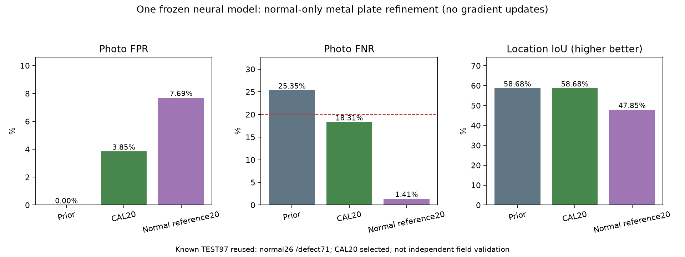

# 금속판 미탐 보강 · 정상 기준과 정상 특징 비교

기준일: 2026-10-14

## 결과

**정상 사진으로 정한 경고 기준 조정안**을 선택했다. 같은 알려진TEST97장(정상26·결함71)에서 오탐1/26=3.85%, 미탐13/71=18.31%로 사진 단위20% 목표를 통과했다. 직전 미탐18/71=25.35%에서5장을 더 발견했으며 정상 사진1장을 추가로 경고했다.
다른 설비의 기준·신경망 가중치·사진 점수·위치heatmap은 유지했다. 금속판에서도 raw사진점수와pixel기준/heatmap은 같다. 추가신경망학습은0회이며 정상자료 기반 보정과참조특징저장 실험이다.

| 항목 | 기존 시제품 | 기준 조정20 | 정상 특징 비교20 |
|---|---:|---:|---:|
| 사진 오탐 | 0.00% | 3.85% | 7.69% |
| 사진 미탐 | 25.35% | 18.31% | 1.41% |
| 위치 IoU | 58.68% | 58.68% | 47.85% |
| 손상pixel 미탐 | 27.96% | 27.96% | 20.04% |
| 사진 미탐 건수 | 18/71 | 13/71 | 1/71 |
| 정상 경고 건수 | 0/26 | 1/26 | 2/26 |

정상 특징 비교는 사진 미탐1/71=1.41%·오탐2/26=7.69%로 좋아졌지만 위치IoU가58.68%→47.85%로 낮아져 이번 선택에서 제외했다. 좋게 나온 사진 수치만 보고 위치 기능까지 개선됐다고 표시하지 않았다.

## 평가 전에 정한 조건

- 두 후보만 비교했다. A는기존신경망·점수·위치결과와pixel기준을유지하고금속판사진경고기준만조정한다. B는같은공통분석부의정상FIT특징과정확한최근접cosine거리로비교한다.
- 두후보의사진경고기준은정상CAL20장만으로순위17번째값을사용한다. ceil((n+1)×0.8), 즉20%정상경고예산을사전에정했다. 기존15%예산은순위18번째였다.
- B는정상FIT34장·8704patch만참조버퍼에저장한다. 입력특징은기존MobileNet low40/high960을따로정규화하고합친뒤3×3지역평균을계산한다. 제2신경망이나원본사진검색서비스를추가하지않았다.
- 모든후보는사진FPR≤20%,사진FNR≤20%,직전보다FNR감소,위치IoU유지,pixelFNR유지의5조건을함께충족해야한다. TEST결함정답으로학습하거나임계값을순회조정하지않았다.
- [PatchCore 논문](https://arxiv.org/abs/2106.08265)의정상patch참조아이디어를참고했지만동일구조·동일학습·동일성능을재현한구현이라고주장하지않는다.

## 현재 목표 상태

| 신규 유형 | 사진 목표 상태 |
|---|---|
| 부품 표면 | 기존오탐12.64%·미탐10.91% 유지·15%목표통과 |
| 금속판 | 이번오탐3.85%·미탐18.31%·20%목표통과 |
| 나머지9개 | 기존보강필요/평가표본부족상태유지 |

같은공개평가사진을재사용한비교다. 정상26장은표본이작고원래촬영장소·물리적부품그룹을검증하지못했으므로독립스마트폰산업현장성능이아니다. 금속판pixel미탐27.96%는그대로라위치기능은사진20%목표와분리해보강해야한다.

## 실제 보존·연결

기존자료·모델·보고서61,345개의SHA와mtime,기존Python소스487개의SHA를보존했다. 두후보의모든기존신경망tensor는직전시제품과정확히같다. 부품표면을포함한다른10유형CPU출력정확일치와11유형CPU/GPU일치를확인했다.
모델가중치가같아도사진경고기준과분석정책이달라질수있으므로modelSha256과inferencePolicySha256을함께저장한다. 새CPU서버는금속판의normalCALAlpha20%/rank17정책을명시한다. 기존3항목과새11유형의요청계약은유지한다.
선택후보는새역할4시제품전달물로구분한다. 기존전달ZIP과일반앱기본모델은자동교체하지않는다. 실제분리ZIP·CPU·C++연결검사는release기록을확인한다.

선택모델SHA: `0f9b7322ae5d8e0aea8cc7a10655eff04e5f6dd2ed6c6bcf585fb05a3179c5f0`

- [사전 조건](equipment-metal-reference-v1-protocol.json)
- [선택 결과](equipment-metal-reference-v1-selection.json)
- [기준 조정 검증](equipment-metal-reference-v1-calibration_only20-validation.json)
- [정상 특징 검증](equipment-metal-reference-v1-normal_reference20-validation.json)
- [보존 검증](equipment-metal-reference-v1-verification.json)
- [원래 전체 유형 성능](EQUIPMENT_EXPANSION_RESULTS_KO.md)
- [같은 자료 출처·조건](EQUIPMENT_EXPANSION_ATTRIBUTION_KO.md)
- [역할4 연결](../../docs/METAL_CALIBRATION_HANDOFF_KO.md)
