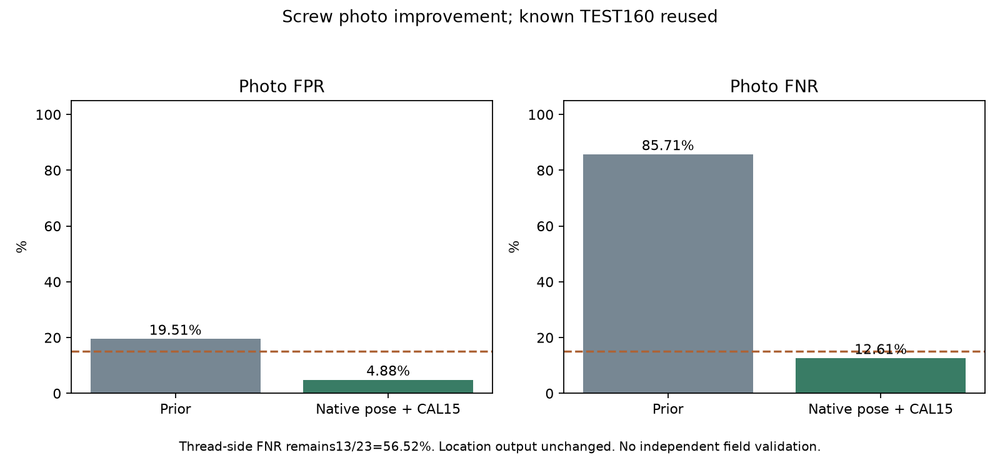

# 원본 정보·나사 방향 보정으로 사진 미탐 개선

기준일: 2026-10-15

## 선택 결과

| 항목 | 기존 모델 | 선택 후보 |
|---|---:|---:|
| 사진 오탐 | 8/41 = 19.51% | 2/41 = 4.88% |
| 사진 미탐 | 102/119 = 85.71% | 15/119 = 12.61% |
| 사진 평가 | 정상41·결함119 | 같은160장 재사용 |
| 나사 위치pixel 미탐 | 97.20% | 97.20% 유지 |

나사 전체 사진에서 오탐·미탐15% 목표를 충족했다. 사진미탐87장을줄였고정상오경고6장을줄였다. 신규11유형중5개가20%이내,그중4개가15%이내다. 기존케이블·너트·금속판·부품표면결과는같다.

**나사산 옆면 손상은 미탐13/23=56.52%가 남는다.** 종류별결과를합산사진수치와함께공개한다. 모든나사손상종류와새산업현장에대한15%성능을보장하지않는다.

## 손상 종류별 결과

| 종류 | 미탐/결함 사진 | 미탐률 |
|---|---:|---:|
| 앞부분 변형 | 1/24 | 4.17% |
| 머리 긁힘 | 0/24 | 0.00% |
| 목 부분 긁힘 | 0/25 | 0.00% |
| 나사산 옆면 | 13/23 | 56.52% |
| 나사산 끝부분 | 1/23 | 4.35% |

## 변경한 내용

- 입력만으로Otsu배경분리·주축PCA·머리가넓은쪽정렬을수행했다. 마스크정답이나이상예측으로위치/방향을고르지않는다. 원본1024×1024에서나사주변을768×256으로등방변환한다.
- 정상FIT96장의기존공통신경망low40/high960특징73,728개를같은모델파일의FP16참조버퍼에추가했다. 사진점수는정확한최근접cosine거리상위1%평균이다.
- 기존256입력위치출력과새방향보정입력을같은신경망으로각1회처리한다. 한모델·한공통분석부·나사사진당2회다. 기존신경망가중치와케이블/너트참조는모두같다.
- 이번v6/v7의추가신경망optimizer업데이트는0회다. 정상특징적합과입력처리·정상CAL기준개선이다. 앞선v5의40epoch·2560번학습은미채택상태로보존했다.
- 입력품질검사976장중실패0장. 실사용에서객체방향/배경분리가불분명하면422와수동검수요청으로처리한다.

## 평가 전에 정한 비교

| 후보 | 사진 오탐 | 사진 미탐 | 선택 |
|---|---:|---:|---|
| screw_hilo/normalCAL10 | 0.00% | 21.01% | 제외 |
| screw_hilo/normalCAL05 | 0.00% | 21.85% | 제외 |
| screw_fine/normalCAL10 | 0.00% | 36.13% | 제외 |
| screw_fine/normalCAL05 | 0.00% | 37.82% | 제외 |
| 같은aligned_hilo/normalCAL15 | 4.88% | 12.61% | 선택 |
| 같은aligned_hilo/normalCAL20 | 21.95% | 2.52% | 오탐 초과로 제외 |

v6에서는4입력/특징후보와각CAL10/CAL05를먼저고정했다. 나사hilo가오탐0%·미탐21.01%였지만20%에못미쳐제외했다. 그결과를본뒤v7에서나사hilo에한해CAL15/CAL20두정상경고기준을추가로사전등록했다.
선택기준은정상CAL24장의22번째값이다. TEST점수분위수로임계값을고르거나TEST결함을학습에넣지않았다. 다만이미본공개TEST로후보를비교하고다음회차를설계한개발과정이므로독립검증결과는아니다.

## 연결부와 새 실제 손상 자료

전선연결부는원래2:1비율을1024×512로보존하고지역특징과전체배치를시험했다. 결합후보CAL10은오탐19.33%·미탐39.38%로20%동시목표미달이어서반영하지않았다.
볼스크루분류자료21,835장을공식경로에서받아정상/피팅손상라벨을확인했다. 회전본·정확중복·근접pHash를묶어학습/보정/예약평가를분리했고예약평가의모델예측은계산하지않았다. 이자료는일반체결나사사진과다른설비표면자료이며이번나사모델에는사용하지않았다.
[볼스크루분류자료원출처](https://publikationen.bibliothek.kit.edu/1000133819)는CCBY-NC4.0이고파일명N/P라벨과90도회전변형을설명한다. 검수중명목150×150과다른크기가확인되어원본을그대로보존하고실제크기를기록했다. 촬영원본프레임·물리적설비별그룹은검증하지못했으므로새현장독립평가로표시하지않는다.
[BSData원자료](https://github.com/2Obe/BSData)도고정리비전에서받아선택한JPEG/JSON/license의Git체크섬을확인했다. 외부코드나저장모델을추출·실행하지않았다. 두자료모두아직학습결과를주장하지않는다.

## 보존·연결

기존자료·모델·보고서62,698개의SHA/mtime과기존Python소스519개의SHA를보존했다. 기존신경망tensor와정상참조는정확히같고다른10유형의기준·출력도유지했다.
기존위치heatmap은그대로라나사pixel미탐97.20%는별도보강이필요하다. 새참고heatmap은입력변환을역으로적용해원본좌표에표시하며비교영역mask를함께준다. 새참고heatmap의위치IoU를측정한분할결과는아니다.
역할4전달은새모델파일하나와새CPU서버모듈을사용한다. 기존기본앱을자동배포한것은아니며실제ZIP·CPU·C++검사기록을확인한다.

선택모델SHA: `14a26d0b4c69f4d86c12cfe50daeadad6d79935ae552fc37610a9c465815097a`

- [v6 사전 조건](equipment-native-components-v6-protocol.json)
- [v6 비교·제외](equipment-native-components-v6-selection.json)
- [v7 사전 조건](equipment-native-screw-budget-v7-protocol.json)
- [v7 전체 결과](equipment-native-screw-budget-v7-validation.json)
- [v7 선택](equipment-native-screw-budget-v7-selection.json)
- [v7 보존 검증](equipment-native-screw-budget-v7-verification.json)
- [새 라벨 자료 검수](bsclass-v1-data-audit.json)
- [역할4 실행·화면 연결](../../docs/NATIVE_SCREW_HANDOFF_KO.md)
- [앞선 실제 학습과 실패 결과](COMPONENT_DEVELOPMENT_RESULTS_KO.md)
- [기존 학습자료 출처](EQUIPMENT_EXPANSION_ATTRIBUTION_KO.md)
