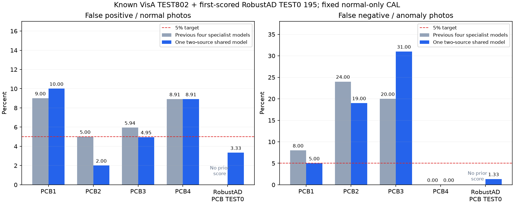

# 두 데이터셋으로 학습한 단일 PCB 모델 · 2026-10-12

## 여러 데이터셋을 하나에 학습했는가

**이번 실험은 그렇다. VisA와 RobustAD 두 출처의 정상 PCB 사진으로 하나의 학생 신경망을 함께 학습했다.** 기판 유형5종에 같은 학생 가중치·체크포인트를 사용하고, 유형별 정상 경고 기준만 다르다. 고정 ImageNet 교사와 학습 학생이 하나의 외관 이상 검출 모델을 구성한다. 기판별 학생 모델5개를 따로 학습한 것이 아니다.

이전 최근 실험은 VisA의 PCB1~4를 각기 다른 모델로 학습했고, 벨트 균열과 이물질도 각각 다른 데이터 출처·모델이었다. 이전 건물 모델은 여러 자료를 통합했으나 이를 최근 PCB·벨트도 여러 출처로 학습했다는 뜻으로 설명하지 않는다.

## 두 출처의 실제 원본

| 출처 | 정상 FIT | 정상 CAL | TEST 정상/불량 |
|---|---:|---:|---:|
| VisA PCB1~4 | 3,250 | 364 | 402/400 |
| RobustAD PCB | 140 | 40 | 120/75 |
| 합계 | 3,390 | 404 | 522/475 |

[공식 VisA](https://github.com/amazon-science/spot-diff)와 [공식 RobustAD](https://huggingface.co/datasets/AmazonScience/RobustAD/blob/main/README.md)는 CC BY4.0 자료다. RobustAD는 revision `82c642b2d18be60f2dab104f8dd4dea1f4ccfacb`를 고정했다. PCB TRAIN 정상180장과 TEST0 사진195장·원본 마스크75개, 총450개 파일716,662,533바이트를 확보했다. 작성자의 메타데이터 정답을 유지하고 TRAIN 불량75장과 TEST1~5는 이번 학습·평가에 사용하지 않았다.

450개 원본 중 작성자 LFS 전체 SHA256을 확인한 파일은 450개다. 모든 확보 파일의 로컬 SHA를 기록했다. 전체4,791장의 decoded RGB를 비교한 완전 동일 중복은0건이다. 유사 사진·같은 물리적 기판·촬영 세션의 독립성을 증명한 것은 아니다.

## 실제 학습과 평가 분리

**하나의 모델 실제40epoch·5,000회 가중치 업데이트·12.22분**을 완료했다. 사전 시험1업데이트는 본학습에서 제외한다. 사전 시험에서 두 출처 각각의 loss가 같은 학생 파라미터에 실제 gradient를 주는 것도 확인했다.

매 epoch 각 유형800회, 합계4,000회 사진을 뽑아 학습했다. VisA 3,200회·RobustAD 800회로 소수 출처를 보강하는 replacement sampling이다. 반복 샘플링160,000회를 새로운 원본 사진160,000장으로 계산하지 않는다. 실제 고유 FIT 원본은3,390장이다.

정상 FIT만 가중치 업데이트에 사용했다. 기존 VisA CAL91장씩과 별도 RobustAD CAL40장으로 유형별 사진 기준·픽셀 기준을 정한 뒤 TEST를 추론했다. 최종40epoch를 학습 전에 고정했으며 TEST로 epoch·경고 기준을 조정하지 않았다.

이번에는 데이터 추가와 함께 단일 모델 통합·seed·샘플링·가중치 업데이트량도 달라졌다. 아래 비교는 전체 recipe 비교이며 데이터 추가만의 효과를 분리한 실험은 아니다. 원저자 Reverse Distillation의 아이디어를 참고한 자체 소형 구조이고 논문 조건 재현은 아니다.

## 사진 단위 결과

| 유형 | 정상/불량 | 이전 오탐→새 오탐 | 이전 미탐→새 미탐 | 새 AUROC |
|---|---:|---:|---:|---:|
| pcb1 | 100/100 | 9.00% → 10건 (10.00%) | 8.00% → 5건 (5.00%) | 0.9663 |
| pcb2 | 100/100 | 5.00% → 2건 (2.00%) | 24.00% → 19건 (19.00%) | 0.9566 |
| pcb3 | 101/100 | 5.94% → 5건 (4.95%) | 20.00% → 31건 (31.00%) | 0.9303 |
| pcb4 | 101/100 | 8.91% → 9건 (8.91%) | 0.00% → 0건 (0.00%) | 0.9979 |
| robustad_pcb | 120/75 | 이전 평가 없음 → 4건 (3.33%) | 이전 평가 없음 → 1건 (1.33%) | 0.9926 |

같은 VisA802장 합산: 이전 오탐29/402(7.21%)·미탐52/400(13.00%) → 새 **오탐26/402(6.47%)·미탐55/400(13.75%)**.

처음 평가한 RobustAD TEST0: **오탐4/120(3.33%)·미탐1/75(1.33%)**. 이전 모델 점수가 없으므로 개선률을 만들지 않는다.

5유형의 오탐·미탐10개가 모두5% 미만인 기준: **미달**. 출처·유형별 수치를 합산으로 감추지 않는다. 기준을 정상 CAL5%로 설정했다고 TEST 오탐5%를 보장하는 것은 아니다.

## 위치 표시와 적용 범위

| 유형 | 모델256 IoU | 리사이즈로 사라진 양성 마스크 |
|---|---:|---:|
| pcb1 | 16.31% | 0 |
| pcb2 | 8.79% | 0 |
| pcb3 | 9.81% | 0 |
| pcb4 | 9.61% | 0 |
| robustad_pcb | 0.25% | 0 |

원저자 원본 마스크를256×256 nearest로 변환하고 정상 CAL 픽셀 quantile0.995 기준으로 평가했다. 정상 사진의 픽셀 오탐도 포함한다. 원본 해상도 정밀 위치 성능이 아니며 heatmap은 특징 차이 확인용이다. 원본 크기로 확대해도 새로운 세부 정보를 복구하지 않는다.

VisA802장은 이미 알려진 재사용 벤치마크다. RobustAD TEST0는 이번 모델의 최초 평가지만 새 공장·새 물리적 기판·촬영 세션의 독립성을 확인하지 않았다. RobustAD TEST1~5의 조명·구도 조건 전체를 검증한 것으로 소개하지 않는다.

대상은 두 출처의 등록된5개 PCB 유형 근접 외관이다. 벨트/기계/건물 자료를 섞지 않았고 범용 설비 고장·전기 작동·내부 고장을 판단하지 않는다. 기존 모델·전달 파일을 보존하고 이번 모델을 별도 연구 후보로 제공한다. 앱 기본 모델은 자동 교체하지 않았다.

## 재현과 전달

- [추가 자료 확보·해시 요약](robustad-pcb-acquisition-summary.json)
- [본학습 전 고정한 조건](pcb-multisource-protocol.json)
- [실제 학습과 하나의 가중치 SHA](pcb-multisource-training.json)
- [출처별 사진·픽셀 수치](pcb-multisource-results.json)
- [같은 VisA 사진의 교정·새 오류](pcb-multisource-paired-errors.json)
- [데이터·기존 모델·소스 보존 검증](pcb-multisource-verification.json)
- [이전4종 모델 결과](pcb-reverse-results.json)
- [역할4 단일 모델 API 연결](../../docs/PCB_MULTISOURCE_HANDOFF_KO.md)
