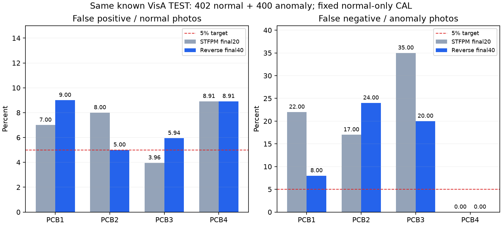

# PCB 회로기판 4종 실제 재학습 결과 · 2026-10-12

## 실제로 진행한 작업

정상 학습 사진3,250장으로 종류별40epoch, 합계 **160 category-model epoch·4,160회 가중치 업데이트**를 완료했다. 네 모델을 순차 학습한 전체 시간은 10.41분이다. 일회용 사전 시험1업데이트는 본학습에 포함하지 않는다.

ImageNet ResNet18 교사는 고정하고, 정상 특징을 압축한 뒤 3개 해상도로 복원하는 별도 학생 모델을 학습했다. [Reverse Distillation 원저자 구현](https://github.com/hq-deng/RD4AD)의 개념을 참고한 자체 소형 구현이며 논문 재현 모델은 아니다. 이전 모델과 구조·지도 집계 방식·학습량이 함께 달라 순수 구조 변경의 효과로 해석하지 않는다.

공식 [VisA PCB1~4](https://github.com/amazon-science/spot-diff) 자료(CC BY4.0)만 사용했다. 각 종류 정상 CAL91장으로 사진 기준과 위치 표시 기준을 먼저 고정했다. 불량 CAL, TEST, 새 AI/사람 라벨을 학습하거나 기준 조정에 쓰지 않았다. 마지막40epoch를 미리 선택했으며 TEST 성능에 따라 epoch나 기준을 고르지 않았다.

## 같은 공식 시험 사진 비교

| 유형 | 정상/불량 수 | 이전 오탐 | 새 오탐 | 이전 미탐 | 새 미탐 | 새 AUROC |
|---|---:|---:|---:|---:|---:|---:|
| PCB1 | 100/100 | 7건 (7.00%) | 9건 (9.00%) | 22건 (22.00%) | 8건 (8.00%) | 0.9606 |
| PCB2 | 100/100 | 8건 (8.00%) | 5건 (5.00%) | 17건 (17.00%) | 24건 (24.00%) | 0.9509 |
| PCB3 | 101/100 | 4건 (3.96%) | 6건 (5.94%) | 35건 (35.00%) | 20건 (20.00%) | 0.9422 |
| PCB4 | 101/100 | 9건 (8.91%) | 9건 (8.91%) | 0건 (0.00%) | 0건 (0.00%) | 0.9963 |

합산 오탐: **28/402 (6.97%) → 29/402 (7.21%)**. 합산 미탐: **74/400 (18.50%) → 52/400 (13.00%)**.

종류별 오탐·미탐 8개 모두5% 미만: **미달**. 합산 수치와 종류별 수치를 함께 보며 악화된 항목도 표에서 확인한다.

## 위치 표시 평가

| 유형 | 모델256 좌표 IoU | 리사이즈 후 정답이 사라진 사진 |
|---|---:|---:|
| PCB1 | 17.49% | 0 |
| PCB2 | 7.84% | 0 |
| PCB3 | 8.83% | 0 |
| PCB4 | 9.71% | 0 |

원저자 불량 마스크를256×256으로 nearest 리사이즈한 정답과, 정상 CAL 픽셀 분포에서 고정한 기준을 비교했다. 정상 사진의 배경 오탐도 IoU 분모에 포함된다. 작은 결함은 리사이즈로 사라질 수 있어 원본 해상도 위치 정확도로 해석하지 않는다. 이전 모델에는 픽셀 평가가 없어 위치 개선률은 제시하지 않는다. heatmap은 특징 차이이며 불량 확률·확정 결함 위치가 아니다.

## 해석과 다음 작업

시험802장은 이전에도 사용한 알려진 공식 벤치마크다. 정확히 같은 사진 ID와 정답으로 비교했으나 새 공장·새 물리적 기판·촬영 세션의 독립성은 확인되지 않았다. 정상 CAL5% 목표는 실제 TEST 오탐5%의 보장이 아니다. 이 결과를 산업현장 전체 오차율로 소개하지 않는다.

현재 대상은 등록된 PCB1~4 종류의 근접 외관이다. 전체 배전반, 다른 기판, 작동·절연·과열·내부 고장을 판단하지 않는다. 연구 후보를 별도 API로 제공하며 기존 앱 기본 모델은 자동 교체하지 않는다. 오류 사진은 다음 실험을 위한 분석 자료로 보존하되, 동일 TEST를 조정 자료로 쓰면 새 독립 검증 자료가 필요하다.

## 재현·검증 파일

- [학습 전 고정한 프로토콜](pcb-reverse-protocol.json)
- [실제 학습 기록](pcb-reverse-training.json)
- [사진·픽셀 결과](pcb-reverse-results.json)
- [동일 사진별 새 오류·교정 목록](pcb-reverse-paired-errors.json)
- [원본·기존 모델·소스 보존 검증](pcb-reverse-verification.json)
- [이전 모델 고정 결과](equipment-visa-results.json)
- [역할4 API 연결](../../docs/PCB_REVERSE_HANDOFF_KO.md)
