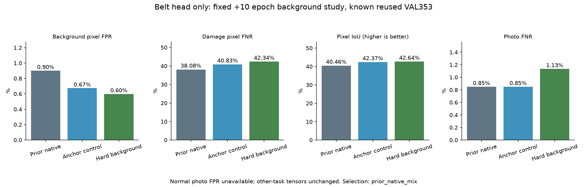

# 통합 메인 · 벨트 배경 오탐 감소 학습 결과

기준일: 2026-10-13

## 실제 작업

원본 손상 부위 학습으로 개선된 native_mix 통합 모델에서 시작해, 벨트 출력 부분만 두 조건으로 추가 학습했다. 공통 분석부·시설·이물질 가중치와 모든 BN 통계는 고정했다. 앱에서 모델 파일 하나를 사용한다.

- 후보마다 **10epoch·1,280회**, 합계 **20후보 epoch·2,560회** 실제 GPU 추가 업데이트다. 기준 모델 이력은 최초 통합20회·6,400회와 원본 벨트 부분10회·1,280회다. 두 연구 후보의 추가 횟수를 하나의 모델에 합산하지 않는다.
- 기존 TRAIN1,397장 및 작성자 원본에서 만든 crop1,397개를 그대로 재사용했다. 후보마다 같은 ID·순서·추출·반전·손실·학습률을 적용하며 배치8장 중4장은 전체 사진,4장은 원본 crop이다. 새 독립 사진과 새 정답은0개다.
- 두 후보 모두 기존 BCE posweight20+Dice에 손상 보존 항목을 넣었다. 작성자 손상 마스크와 valid가 참이고 기준 모델 점수가0.5이상인 픽셀만 사용해, 점수가 떨어지는 방향에 보존 손실을 준다. 기준 모델은 동결되어 학습되지 않으며 확률을 새 정답으로 저장하지 않는다.
- hard_background 후보에만, 손상 주변3pixel 경계대를 제외한 작성자 유효 background 중 점수가 높은 상위1%의 negative BCE를0.05비중으로 추가했다. anchor_control은 이 추가 항목이0이다. 작성자 background pixel은 전체 사진 정상/기계 정상 정답이 아니다.
- 마지막10회차만 같은 알려진 VAL353장에서 고정기준0.5로 평가했다. epoch별 VAL 튜닝·early stopping·예약 TEST 사용은 없다. 기준 모델은 학습 보존용이며 배포 ZIP에 별도 교사를 넣지 않는다.

| 후보 | 실제 추가 epoch | 실제 업데이트 | 시간 | 원본 crop / 전체사진 반복 추출 |
|---|---:|---:|---:|---:|
| anchor_control | 10 | 1,280 | 2.42분 | 5,120 / 5,120 |
| hard_background | 10 | 1,280 | 2.51분 | 5,120 / 5,120 |

## 같은 알려진 VAL353장·4개 촬영 구간

| 지표 | 기준 native_mix | anchor_control | hard_background |
|---|---:|---:|---:|
| background pixel 오탐률 | 0.90% | 0.67% | 0.60% |
| 손상 pixel 미탐률 | 38.08% | 40.83% | 42.34% |
| 손상 위치 IoU | 40.46% | 42.37% | 42.64% |
| 사진 미탐률 | 0.85% | 0.85% | 1.13% |
| 사진 미탐 건수 | 3/353 | 3/353 | 4/353 |
| 정답 위치와 전혀 겹치지 않는 손상 사진 | 37 | 38 | 38 |
| 정상 사진 오탐률 | 미측정·정상0장 | 미측정·정상0장 | 미측정·정상0장 |

배경 픽셀 오탐과 정상 사진 오탐은 다른 지표다. 사진 미탐은 후보가 전혀 나오지 않은 사진 비율이고, 정답 위치와 겹침 없는 사진은 다른 곳만 표시한 경우도 포함한다. 위치 IoU·pixel 미탐도 함께 확인한다. 재사용한 VAL의 연구 비교로 독립 현장 성능을 주장하지 않는다.

## 사전 조건과 선택

선택: **prior_native_mix**. 배경pixel 오탐이 기준보다 상대10% 이상 줄고, IoU·사진 미탐·손상pixel 미탐·정답 겹침 실패가 모두 나빠지지 않아야 한다. 통과 후보는 낮은 오탐, 높은IoU, control 순으로 선택한다. 실패하면 직전 native_mix를 유지한다.

| 후보 | 배경 오탐10% 이상 감소 | IoU 유지 | 사진 미탐 유지 | pixel 미탐 유지 | 정답 겹침 실패 유지 |
|---|---|---|---|---|---|
| anchor_control | 통과 | 통과 | 통과 | 실패 | 실패 |
| hard_background | 통과 | 통과 | 실패 | 실패 | 실패 |

## 보존·연결·한계

기존 입력·이전 모델/보고서37,920개 및 기존 Python소스430개를 SHA로 보존했다. 최종 가중치가 마지막progress와 같고, 실제 journal은 합계2,560회다. 모든 비벨트 tensor가 기준과 byte 동일하며 시설·이물질 TRAIN CPU 예측도 정확히 같고3개기능 CPU/GPU 일치를 확인했다.

시설·이물질 수치는 기존 통합v1에서 계승하며 이번 회차에 새 평가를 했다는 뜻이 아니다. 이물질 CAL/TEST를 다시 평가하지 않았다. 전체 정상 벨트 사진0장이므로 정상 사진 오탐은 미측정이며 전체 산업현장 오탐·미탐5% 미만을 검증하지 못했다. 내부 모터·롤러 고장과 가동 여부는 not_assessed다. 위험 등급·조치·요약은 기존 규칙 템플릿이고 점검자 확인이 필요하다.

선택 후보가 있으면 별도 단일 모델 연구 ZIP을 제공한다. 기존 모델과 전달 파일은 보존하고 앱 기본 모델은 자동 교체하지 않는다.

- [사전 조건](unified-belt-background-protocol.json)
- [학습·재개·보존 검증](unified-belt-background-verification.json)
- [선택 조건별 통과/실패](unified-belt-background-selection.json)
- [control 전체 계수·사진별 결과](unified-belt-background-anchor_control-validation.json)
- [배경 집중 전체 계수·사진별 결과](unified-belt-background-hard_background-validation.json)
- [실행 파이프라인](../../docs/UNIFIED_BELT_BACKGROUND_STUDY_KO.md)
- [기준 모델의 원본 손상 부위 학습](UNIFIED_BELT_DETAIL_RESULTS_KO.md)
- [기존 통합 모델의 다른 기능 성능](UNIFIED_MAIN_RESULTS_KO.md)
- [출처·사용 조건](UNIFIED_MAIN_ATTRIBUTION_KO.md)
