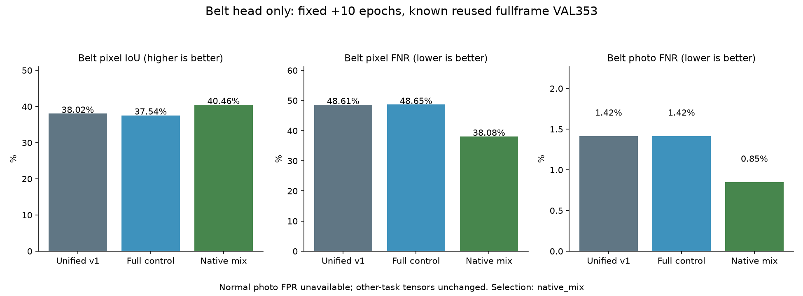

# 통합 메인 · 벨트 원본 손상 부위 추가 학습 결과

기준일: 2026-10-13

## 실제 수행

동일한 완료 통합 v1에서 벨트 출력 부분만 실제 추가 학습했다. 공통 MobileNet 분석부·시설 출력·이물질 출력의 모든 tensor와 BN 통계는 정확히 유지했다. 시설·벨트·이물질을 처리하는 기존 모델 파일 하나의 구조를 그대로 사용한다.

- 후보마다 **10epoch·1,280회**, 합계 **20후보 epoch·2,560회** 실제 추가 업데이트. 두 후보의 journal은 합계2,560회이며 완료 가중치에 반영된 업데이트와 재실행 기록을 구분한다.
- 작성자 TRAIN 1,397장에서 원본 crop 1,397개를 만들고 검증했다. 실제 학습에 예약한 고유 TRAIN은1,397장이다. 새 독립 사진·새 AI 정답은 0개다.
- full_control은 기존 전체 640 사진만 학습했다. native_mix는 같은 ID·순서에서 배치 8장 중 4장을 원본 손상 부위 crop으로 바꿨다. 손실·학습률·추출 수·좌우 반전·seed는 같다.
- 원본 JSON·포함 사진 SHA와 디코딩 RGB를 검증하고 기존 전체 사진·마스크·유효 영역의 픽셀 일치를 모두 확인했다. native crop은 원본에서 자른 것으로 기존 640 사진 확대와 다르다.
- 첫 작성자 손상 도형 중심 주변을 최소 720 native pixel 정사각형으로 잘라 640으로 바꿨다. 모든 원래 도형을 같은 좌표로 변환하고 crop 경계에서 잘랐다. 전체 사진과 crop을 섞어 같은 전체 사진 평가 조건을 유지했다.
- 모든 회차에 다른 기능 가중치가 바뀌지 않았음을 확인했다. 64회마다 재개 상태를 저장했다. 마지막 10회차만 평가하고 epoch별 VAL 선택은 하지 않았다.

| 후보 | 실제 추가 epoch | 업데이트 | 학습·가중치 검사 시간 | 원본 crop 추출 | 전체 사진 추출 |
|---|---:|---:|---:|---:|---:|
| full_control | 10 | 1,280 | 2.26분 | 0 | 10,240 |
| native_mix | 10 | 1,280 | 2.05분 | 5,120 | 5,120 |

## 같은 알려진 VAL353장·4개 촬영 구간

평가 입력은 crop이 아닌 기존 전체 사진 640이며 손상 기준은 모두 0.5다. 예약된 작성자 TEST는 사용하지 않았다. 재사용된 VAL 연구 비교이며 독립 산업현장 검증이 아니다.

| 지표 | 통합 v1 | full_control | native_mix |
|---|---:|---:|---:|
| 사진 미탐률 | 1.42% | 1.42% | 0.85% |
| 사진 미탐 건수 | 5/353 | 5/353 | 3/353 |
| 손상 위치 pixel IoU | 38.02% | 37.54% | 40.46% |
| 손상 pixel 미탐률 | 48.61% | 48.65% | 38.08% |
| background pixel 오탐률 | 0.60% | 0.63% | 0.90% |
| 정답 위치와 겹침 없는 손상 사진 | 41 | 39 | 37 |
| 정상 사진 오탐률 | 미측정·정상 0장 | 미측정·정상 0장 | 미측정·정상 0장 |

사진 미탐은 사진 전체에서 후보가 전혀 검출되지 않은 비율이다. 정답 위치와 겹침 없는 사진은 다른 위치만 표시하는 경우도 포함한다. 위치 IoU와 pixel 미탐을 별도로 제시하며 background pixel 오탐을 정상 사진 오탐으로 발표하지 않는다.

## 사전 조건에 따른 연구 선택

선택: **native_mix**. 사전 기준은 위치 IoU 최소 0.5%p 개선, 사진 미탐·pixel 미탐·정답 겹침 없는 사진 수가 v1보다 나빠지지 않는 것이다. 모두 통과한 후보에서 IoU, pixel 미탐, control 순으로 선택했다. 두 후보가 실패하면 기존 v1을 유지한다.

| 후보 | IoU +0.5%p 이상 | 사진 미탐 유지 | pixel 미탐 유지 | 위치 겹침 실패 유지 |
|---|---|---|---|---|
| full_control | 실패 | 통과 | 실패 | 통과 |
| native_mix | 통과 | 통과 | 통과 | 통과 |

## 다른 기능과 앱 연결

시설·이물질·공통 분석부의 모든 상태 tensor는 v1과 byte 동일하다. 각 기능 TRAIN 사진 2장의 CPU 예측도 정확히 같고 3개 기능 CPU/GPU 예측 일치를 확인했다. 시설·이물질의 기존 알려진 수치는 v1에서 계승하며 이번 회차에 다시 시험했다고 표시하지 않는다. 이물질 CAL·TEST를 다시 보정하거나 선택에 사용하지 않았다.

선택 후보는 추가 연결 연구용이다. 기존 앱 기본 모델은 자동 교체하지 않는다. 정상 벨트 정답·독립 산업현장 검증이 없어 전체 오탐·미탐 5% 미만을 확인하지 못했다. 내부 모터·롤러 고장과 가동 여부는 not_assessed다. 위험 등급·조치·요약은 기존 규칙 템플릿이고 점검자의 최종 확인이 필요하다.

- [사전 등록 조건](unified-belt-detail-protocol.json)
- [원본·학습·재개·다른 기능 보존 검증](unified-belt-detail-verification.json)
- [선택 조건별 통과·실패](unified-belt-detail-selection.json)
- [전체 사진 control 계수·사진별 결과](unified-belt-detail-full_control-validation.json)
- [원본 crop 혼합 계수·사진별 결과](unified-belt-detail-native_mix-validation.json)
- [실행 파이프라인](../../docs/UNIFIED_BELT_DETAIL_STUDY_KO.md)
- [기존 통합 v1 전체 기능 수치](UNIFIED_MAIN_RESULTS_KO.md)
- [출처·사용 조건](UNIFIED_MAIN_ATTRIBUTION_KO.md)
