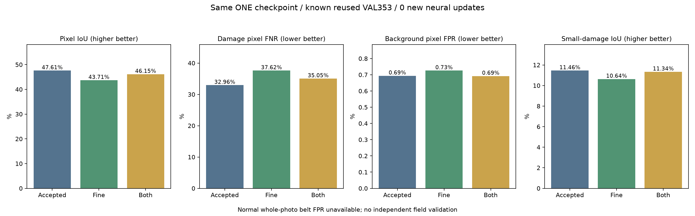

# 벨트 작은 손상 · 세밀 구역 분석 비교

기준일: 2026-10-13

## 이번 작업

**추가 가중치 학습0회·새 독립 사진0장·새 정답0개**다. 현재 선택한 native_mix 가중치를 동일하게 사용하고, 원본 구역 분석 크기와 결합 방식만 사전에 정한2개 후보로 비교했다. 모델 파일 하나·공통 MobileNet 분석부 하나를 반복 사용한다. 이번 비교를 모델 재학습으로 세지 않는다.

기존 알려진 VAL353장·4개 촬영 구간을 반복 사용한 연구 비교다. 실제 산업현장 일반화·새로운 독립 검증의 결과가 아니다. 예약 TEST는 사용하지 않았다. 기준0.5와 작성자640 mask 평가 좌표를 유지했다.

## 전체 비교

| 항목 | 기존 전체＋구역 | 전체＋세밀 구역 | 전체＋기존·세밀 구역 |
|---|---:|---:|---:|
| 위치 IoU | 47.61% | 43.71% | 46.15% |
| 손상 pixel 미탐 | 32.96% | 37.62% | 35.05% |
| 배경 pixel 오탐 | 0.69% | 0.73% | 0.69% |
| 손상 사진 미탐 | 0.57% | 0.28% | 0.57% |
| 손상 사진에서 정답과 겹친 예측이 전혀 없음 | 28 | 26 | 31 |
| 정상 벨트 사진 오탐 | 미측정 | 미측정 | 미측정 |

배경 pixel 오탐은 손상 사진 안에서 mask 밖의 pixel을 분모로 한 값이다. 정상 전체 사진의 오탐과 다르다. 모든 사진이 작성자 손상 사진이라 정상 사진 오탐 분모는0이며 값은 null이다. 사진 미탐은 최대 출력이0.5를 넘는지로 측정하므로 위치 IoU와 함께 확인해야 한다.

## 작은 손상과 촬영 구간별 오류

손상 영역이 유효 사진의0.25% 이하인55장이 작은 손상 묶음이다. 이는 작성자 정답 기반의 사후 설명용 구분이며, 서버의 구역 선택에는 정답·손상 크기·모델 점수를 넣지 않는다.

| 묶음·장수 | 기존 IoU / pixel 미탐 | 세밀 IoU / pixel 미탐 | 두 크기 IoU / pixel 미탐 |
|---|---:|---:|---:|
| GT-area:0.25-1% · 134장 | 32.03% / 32.20% | 29.81% / 33.63% | 31.44% / 33.18% |
| GT-area:1-3% · 108장 | 44.43% / 39.88% | 42.54% / 41.42% | 43.91% / 40.48% |
| GT-area:<=0.25% · 55장 | 11.46% / 48.03% | 10.64% / 47.25% | 11.34% / 48.15% |
| GT-area:>3% · 56장 | 61.03% / 28.43% | 55.44% / 36.02% | 58.48% / 31.81% |
| sequence:data24 · 94장 | 64.78% / 20.11% | 60.61% / 27.46% | 63.02% / 23.55% |
| sequence:data25 · 94장 | 21.77% / 45.04% | 19.83% / 49.04% | 20.91% / 47.79% |
| sequence:data26 · 82장 | 38.60% / 46.00% | 34.64% / 44.60% | 36.86% / 44.96% |
| sequence:data27 · 83장 | 42.31% / 42.86% | 39.86% / 47.59% | 41.98% / 44.73% |

## 사전 선택 조건과 결론

기존 설정과 전달 ZIP을 유지한다.

현재 선택한 구역 분석을 기준으로 IoU 최소0.5%p 개선, 배경 오탐·pixel 미탐·사진 미탐·정답 겹침 실패 유지, 작은 손상의 IoU·pixel 미탐 유지, 각 촬영 구간 pixel 미탐 악화1%p 이내를 요구했다. 평가 후에 통과 기준을 완화하지 않았다.

| 조건 | 세밀 구역 | 두 크기 |
|---|---|---|
| IoU_gain_at_least_half_percentage_point | 실패 | 실패 |
| background_pixel_FPR_not_worse | 실패 | 통과 |
| pixel_FNR_not_worse | 실패 | 실패 |
| photo_FNR_not_worse | 통과 | 통과 |
| zero_GT_overlap_not_worse | 통과 | 실패 |
| small_damage_IoU_not_worse | 실패 | 실패 |
| small_damage_pixel_FNR_not_worse | 통과 | 실패 |
| each_known_sequence_pixel_FNR_within_one_percentage_point | 실패 | 실패 |

## 비용·보존·한계

이 검증의 원본 사진은3840×2160 또는2160×3840이다. 기존 모드는전체1회＋구역6회, 세밀 모드는전체1회＋구역15회, 두 크기는전체1회＋6회＋15회로 같은 모델을 호출한다. CPU 서버에서는 처리시간이 늘어날 수 있으므로 별도 TRAIN 입력으로 실제 지연을 확인한 후 전달한다. 640 이하 작은 사진이나 종횡비3 초과 사진은 전체 분석으로 돌아간다.

기존 파일49,862개는 SHA와 수정시간을 보존했고, 기존 Python 소스445개도 SHA가 같다. 기존353장 기준 pixel 계수를 정확히 재현했다. 가중치와 시설·이물질 기능은 변경하지 않았다. 모델SHA `4b6d91c045cf6a33631ed5542c81d8e116166f541e97e6d745e1dfbe3f7fe5e5`와 선택한 정책SHA `c69054cd5699595741dadb3305f5072475fdc6559da24abd5cd14e2a17e90b66`를 함께 기록한다.

독립 산업현장 전체 오탐·미탐5% 미만은 검증하지 못했다. 모터·롤러 내부 고장과 작동 상태는 not_assessed다. 시설·이물질 성능은 기존 결과를 계승하며 새로 평가한 값이 아니다. 기존 앱 기본 모델은 자동 교체하지 않는다.

- [사전 조건](unified-belt-fine-protocol.json)
- [기존 오류 구분](unified-belt-fine-baseline-error-audit.json)
- [선택과 통과 여부](unified-belt-fine-selection.json)
- [보존 확인](unified-belt-fine-verification.json)
- [출처·사용 조건](UNIFIED_MAIN_ATTRIBUTION_KO.md)
- [기존 전달 결과](UNIFIED_BELT_TILES_RESULTS_KO.md)
