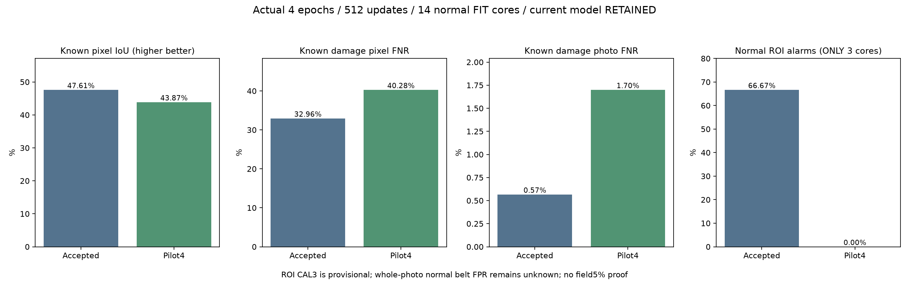

# 정상 벨트 구역 추가 자료 · 초기 학습 결과

기준일: 2026-10-13

## 실제로 완료한 작업

**공개 데이터를 새로 내려받아 검사하고, 기존 통합 모델의 벨트 출력에 실제4epoch·512회 추가 학습했다.** 학습은 모델 하나의 벨트 출력만 바꾼다. 학습용 교사는 예측 보존 제약에만 사용하며 추론에 포함하지 않는다. 공통 분석부·시설·이물질 출력과 BN 통계는 보존했다.

- 실제 학습 시간1.47분. journal 512회, 고유 완료 업데이트512회.
- 기존 작성자 양성 TRAIN 1,369장에3,072draw, 새 작성자 정상 구역14개에1,024draw를 사용했다. 반복 사용 횟수는 새 사진 수가 아니다.
- 새 정상 전체사진 정답0장·새 정상 pixel mask0개다. 정상 bbox 안의 구역 부재 분류 정답을 사용했으며, 사진 전체나 내부 기계 정상으로 확대하지 않았다.
- 실제 학습 파일SHA `c4e70e28cd596f1bc4726fd8be617ce5fd7c598ef442076116af942ae2be103a`. 이 파일은 비교용 pilot으로 보관하고 현재 선택 모델은 그대로 유지한다.

## 출처·자료량·중복 검사

[Gofaones Workspace의 belt defects v2](https://universe.roboflow.com/gofaones-workspace/belt-defects/dataset/2), [v1](https://universe.roboflow.com/gofaones-workspace/belt-defects/dataset/1). 사용 조건은 작성자가 표시한[CC BY4.0](https://creativecommons.org/licenses/by/4.0/)이고 ZIP 안 README.dataset.txt에서도 확인했다. 원래 촬영 기관·장비·촬영 구간 정보는 제공되지 않아 독립 현장 여부를 검증하지 못했다.

- v1 ZIP497장·19,280,690bytes, v2 ZIP1,548장·56,537,347bytes를 실제 수신했다. 증강본을 포함한 파일 수다. v2를 학습 재료로 쓰고 v1은 삭제된 worn surface 라벨 등의 검수에만 사용했다.
- v2 원본 이름 힌트545개 중57개가 작성자 학습·검증·시험 묶음에 걸쳐 있었다. 동일 이름·정확 RGB·회전/반전 pHash 근접성을 합쳐248개 보수적 유사 그룹으로 묶었다. 이름 힌트 수와 그룹 수를 독립 사진·독립 촬영 횟수로 부르지 않는다.
- 정상 bbox의 중앙60% 정사각형을 사용하고 최소64pixel을 요구했다. 어떤 다른 라벨 bbox와도 겹치지 않아야 한다. v1의 마모 라벨이 있는 부모 이름은 제외했고, 제안된 묶음을 가로지르는 유사 그룹도 제외했다. 이전 BeltCrack TRAIN/알려진 VAL과 회전·반전 pHash를 비교했다.
- 남은 정상 구역24개: FIT14·CAL3·보관7. 한 유사 그룹에서 하나만 골랐다. 보관7개는 원본 검수로 조회했지만 가중치 학습·모델 점수 비교에는 쓰지 않았다.
- FIT는 작성자TRAIN의 frame0..149, CAL은frame180..239, 보관은frame270이상 이름 힌트를 사용하고 사이 구간은 제외했다. 이름 숫자가 실제 촬영 순서·영상 ID라는 보장은 없다. 작성자VAL/TEST 원본을 FIT에 넣지 않았다. 작성자 원래 split을 그대로 독립 평가로 믿지 않고 제안된 구간으로 재분리했다.
- 자료는512×512로 변환되고 회전·crop·노출·noise 증강을 포함한다. 고해상도 카메라 원본으로 설명하지 않는다. 작성자 정상 라벨도 현장 점검자의 인증이나 완전한 기계 정상 정답이 아니다.

## 정상 구역 오탐 · 비교용3개만

| 측정 | 기존 선택 모델 | 정상 구역 추가 학습 후보 |
|---|---:|---:|
| 정상 구역의 이상 후보 발생 | 2/3 | 0/3 |
| 구역 오탐 비율 | 66.67% | 0.00% |
| 정상 전체사진 오탐 | 미측정 | 미측정 |

**3개 구역의 비율은 초기 동작 확인 수치다. 전체 산업현장 오탐·미탐5% 미만이나 일반적인 정상 벨트 사진 오탐으로 해석하지 않는다.** 정상 구역도 축소된 bbox에서 나온 부분사진이다. CAL은 이전 미측정 항목을 작은 범위로 처음 비교한 것이며 독립 현장 시험이 아니다.

## 기존 손상 검증353장 · 같은 구역 정책

| 항목 | 기존 선택 모델 | 정상 구역 추가 학습 후보 |
|---|---:|---:|
| 위치 IoU | 47.61% | 43.87% |
| 손상 pixel 미탐 | 32.96% | 40.28% |
| 배경 pixel 오탐 | 0.69% | 0.61% |
| 손상 사진 미탐 | 0.57% | 1.70% |
| 놓친 손상 사진 | 2/353 | 6/353 |
| 정답에 겹친 예측이 전혀 없는 손상 사진 | 28 | 34 |

353장·4개 작성자 구간은 이미 반복 사용한 알려진 VAL이다. 배경pixel 오탐은 손상사진 안에서 mask 밖 pixel을 분모로 한 값이고, 정상 사진 오탐과 다르다. 손상사진 점수는 유효 grid의 전체·구역 결합 출력 최대값이다. 보정된 고장 확률이 아니다. 예약 BeltCrack TEST는 사용하지 않았다.

## 선택과 보존

**사전에 정한 pilot 자료 품질 조건에 따라 현재 모델·정책·역할4 ZIP을 유지했다.** CAL3개와 원래 촬영 구간 정보 부족으로 새 후보는 적용하지 않는다. 이 조건은 학습·새 점수 비교 전에 고정했다.

| 기존 손상 성능 확인 조건 | 결과 |
|---|---|
| IoU_gain_at_least_half_percentage_point | 실패 |
| background_pixel_FPR_not_worse | 통과 |
| pixel_FNR_not_worse | 실패 |
| photo_FNR_not_worse | 실패 |
| zero_GT_overlap_not_worse | 실패 |
| small_damage_IoU_not_worse | 실패 |
| small_damage_pixel_FNR_not_worse | 실패 |
| each_known_sequence_pixel_FNR_within_one_percentage_point | 실패 |

기존 파일50,296개와 Python소스457개의 SHA를 보존했고 입력·이전 보고서 수정시간도 유지했다. 마지막 progress와 final 가중치가 같고 모든 비벨트 tensor는 직전과 같다. TRAIN 입력의3개 기능 CPU/GPU 출력 일치, 이전 시설·이물질 CPU 출력 정확 일치, 원본 구역 CPU/GPU 일치를 확인했다. 새 Qt/C++·Android 실행 시험은 수행하지 않았다.

현재 선택 모델SHA `4b6d91c045cf6a33631ed5542c81d8e116166f541e97e6d745e1dfbe3f7fe5e5`, 정책SHA `c69054cd5699595741dadb3305f5072475fdc6559da24abd5cd14e2a17e90b66`. 기존 앱 기본 모델도 자동 교체하지 않았다. 역할4는 기존 `unified-main-belt-tiles-role4-handoff-2026-10-13-v1.1.zip`을 사용한다.

## 다음 효율적인 작업

현재는 새 데이터를 전부 학습에 넣는 것보다, 원래 촬영 구간을 확인할 수 있는 정상 전체사진과 어려운 손상 사진의 정답을 더 확보하는 것이 우선이다. 이번 수집·검수 코드는 정상 구역만 허용하고 중복과 unknown 범위를 기록하므로 추가 자료를 같은 기준으로 비교할 수 있다. 정상 구역 점수를 사진 전체 정상·수리 완료·모터 내부 고장으로 바꾸지 않는다.

- [다운로드·정답 범위·분리 요약](unified-belt-normal-source-summary.json)
- [사전 조건](unified-belt-normal-protocol.json)
- [실제 학습 기록](unified-belt-normal-training.json)
- [모든 계수와 구역 점수](unified-belt-normal-validation.json)
- [현재 모델 유지](unified-belt-normal-selection.json)
- [보존·재개 확인](unified-belt-normal-verification.json)
- [실행 방법](../../docs/UNIFIED_BELT_NORMAL_STUDY_KO.md)
- [이전 모델의 출처·조건](UNIFIED_MAIN_ATTRIBUTION_KO.md)
