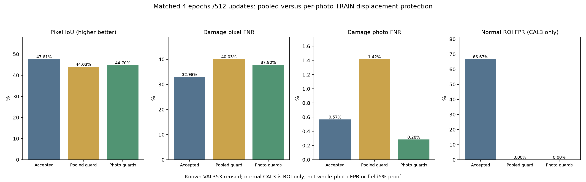

# 사진별 손상 탐지 보호 · 실제 학습 비교

기준일: 2026-10-13

## 이번 변경

정상 영역의 오탐을 줄이면서 손상을 놓치지 않도록, 기존의 배치 전체 양성 pixel 합산 보호를 **손상 사진별 보호 6개**로 바꿨다. 같은 공통 모델·같은 손상 분석부를 학습하며 시설·이물질 분석부는 보존한다.

학습 전 TRAIN 정답만 확인한 결과, 배치 내 가장 큰/작은 손상 pixel 수의 중앙값 차이는 47.98배다. 가장 작은 사진의 합산 양성 pixel 비중 중앙값은 1.13%다. 큰 손상이 기존 보호 계산을 지배할 가능성을 조사한 것으로, 이전 성능 저하의 원인을 확정한 결과는 아니다.

사진마다 양성 pixel 손실을 자기 손상 크기로 나눈 뒤, 실제 Adam 가중치 변화가 6개 중 어느 사진의 손실도 일차 근사로 늘리지 않도록 보정했다. float64 계산 후 실제 저장 dtype에서 모든 조건을 재검사한다. 64회 이내 계산에서 조건을 만족하지 못하면 해당 가중치 변화 전체를 정확히 복원한다. optimizer의 원래 momentum은 유지한다.

이 조건은 **현재 TRAIN 배치의 일차 근사**다. 실제 손실, 검증 사진 미탐, 산업현장 성능을 보장하지 않으므로 검증을 별도로 수행했다.

## 실제 학습 조건

- 실제 4epoch·512 optimizer 업데이트. 실제 journal 512개, 각 업데이트의 사진별 조건 총 3,072개를 확인했다.
- 보정 496회, 정확한 이전 파라미터 복원 0회. 학습 시간 1.15분.
- 초기 모델은 현재 선택 native_mix이며, 앞선 미채택 모델에서 이어 학습하지 않았다. 이전 정상 학습/합산 보호 실험과 동일한 배열·seed443·학습률·손실·4epoch로 비교했다.
- 배치8: 전체 손상 사진4개·기존 contextual crop2개·작성자 정상 ROI2개. 정상 FIT14개를1,024회 사용하고 양성 TRAIN3,072draw를 사용했다. 반복 사용을 새 사진으로 계산하지 않는다.
- BCE posweight20＋Dice＋teacher KL10＋정상 ROI 손실0.5 유지. 이번에 새 사진·새 정답을 추가하지 않았다. 정상 ROI를 정상 전체사진이나 정상 dense pixel mask로 취급하지 않는다.
- 학습 전 protocol을 commit하고 마지막 epoch만 비교했다. 검증 결과를 보고 epoch·임계값·선택 조건을 바꾸지 않았다.

## 같은 알려진 손상VAL353장 비교

| 항목 | 현재 선택 | 앞선 합산 보호 | 이번 사진별 보호 |
|---|---:|---:|---:|
| 위치 IoU | 47.61% | 44.03% | 44.70% |
| 손상 pixel 미탐 | 32.96% | 40.03% | 37.80% |
| 배경 pixel 오탐 | 0.69% | 0.62% | 0.67% |
| 손상 사진 미탐 | 0.57% | 1.42% | 0.28% |
| 놓친 손상 사진 | 2/353 | 5/353 | 1/353 |
| 정답과 겹친 예측 없음 | 28 | 34 | 26 |

현재 선택 대비 기존 미탐 회복 2장, 새 미탐 1장, 지속 미탐 0장이다. 같은 미탐 장수라도 놓친 사진이 바뀔 수 있어 사진 ID와 점수를 별도 보관한다.

배경pixel 오탐의 분모는 손상사진 안의 정답 mask 밖이다. 정상 전체사진 오탐률과 다르다. 기존에 사용한353장·4개 촬영 구간을 반복 비교했으므로 새로운 독립 산업현장 시험으로 해석하지 않는다. 원본 전체＋기존6구역 결합 정책과0.5 기준을 그대로 사용했다.

### 작은 손상과 촬영 구간

| 구분 | 현재 손상pixel 미탐 | 이번 손상pixel 미탐 | 현재 IoU | 이번 IoU |
|---|---:|---:|---:|---:|
| GT-area:0.25-1% | 32.20% | 34.96% | 32.03% | 30.51% |
| GT-area:1-3% | 39.88% | 43.05% | 44.43% | 42.87% |
| GT-area:<=0.25% | 48.03% | 55.33% | 11.46% | 9.98% |
| GT-area:>3% | 28.43% | 34.79% | 61.03% | 56.50% |
| sequence:data24 | 20.11% | 26.54% | 64.78% | 61.60% |
| sequence:data25 | 45.04% | 42.19% | 21.77% | 21.93% |
| sequence:data26 | 46.00% | 48.03% | 38.60% | 36.04% |
| sequence:data27 | 42.86% | 49.78% | 42.31% | 39.12% |

## 정상 ROI 비교 · CAL3개

| 항목 | 현재 선택 | 앞선 합산 보호 | 이번 사진별 보호 |
|---|---:|---:|---:|
| 이상 후보 발생 | 2/3 | 0/3 | 0/3 |
| 정상 ROI 오탐 비율 | 66.67% | 0.00% | 0.00% |
| 정상 전체사진 오탐 | 미측정 | 미측정 | 미측정 |

CAL3은 작성자가 normal belt로 지정한 bbox 내부 구역이고 전체사진·기계적 정상 정답은 없다. 보관 정상7개와 예약BeltCrack TEST의 모델 점수를 계산하지 않았다. 이3개에서0건이어도 산업현장 오탐0% 또는5% 미만의 근거는 아니다.

## 사전 선택 조건과 결론

기존 선택 모델과 역할4 전달 ZIP을 유지한다.

| 조건 | 결과 |
|---|---|
| IoU_gain_at_least_half_percentage_point | 실패 |
| background_pixel_FPR_not_worse | 통과 |
| pixel_FNR_not_worse | 실패 |
| photo_FNR_not_worse | 통과 |
| zero_GT_overlap_not_worse | 통과 |
| small_damage_IoU_not_worse | 실패 |
| small_damage_pixel_FNR_not_worse | 실패 |
| each_known_sequence_pixel_FNR_within_one_percentage_point | 실패 |
| 정상CAL 이상 후보 감소 | 통과 |

현재 선택 대비 IoU0.5%p 이상 개선과 오탐·미탐·작은 손상·각 촬영 구간의 보존 조건8개 및 정상CAL 후보 감소를 모두 요구했다. 일부 지표만 좋아진 가중치는 반영하지 않는다.

- 기존 파일 50,336개의 SHA·mtime와 기존Python소스 469개의 SHA를 유지했다. progress/final 일치와 모든 비벨트tensor 정확 일치를 확인했다.
- 시설·이물질 CPU 출력은 이전과 정확히 같고,3기능과 원본 구역의 CPU/GPU 수치 일치를 확인했다. 이 실험에서 새로운 C++ HTTP 연결 검사는 수행하지 않았다.
- 사진에 보이는 벨트 손상 분석을 보강하는 연구다. 내부 모터 고장·가동 상태·수리 완료·법적 안전 판정을 학습한 것으로 표현하지 않는다.
- 모델 하나·공통 분석부 하나를 사용한다. 교사는 TRAIN 제약용이며 추론에 함께 배포하지 않는다.

선택 모델SHA: `4b6d91c045cf6a33631ed5542c81d8e116166f541e97e6d745e1dfbe3f7fe5e5`
정책SHA: `c69054cd5699595741dadb3305f5072475fdc6559da24abd5cd14e2a17e90b66`
이번 학습 모델SHA: `5ecd6ebd682d850cfb8f58c57b988365c8ae9d854a6defa572b5c95fa1061975`

- [사전 조건](unified-belt-photo-guard-v1-protocol.json)
- [실제 학습](unified-belt-photo-guard-v1-training.json)
- [사진별 검증](unified-belt-photo-guard-v1-validation.json)
- [미탐 변화](unified-belt-photo-guard-v1-photo-changes.json)
- [선택](unified-belt-photo-guard-v1-selection.json)
- [보존·수치 검증](unified-belt-photo-guard-v1-verification.json)
- [앞선 합산 보호 결과](UNIFIED_BELT_RECALL_STEP_RESULTS_KO.md)
- [정상 자료 검수](UNIFIED_BELT_NORMAL_RESULTS_KO.md)
- [출처·라이선스](UNIFIED_MAIN_ATTRIBUTION_KO.md)
- [실행 순서](../../docs/UNIFIED_BELT_PHOTO_GUARD_KO.md)
