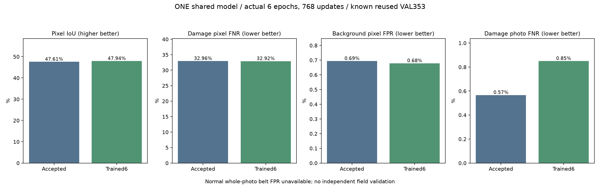

# 벨트 손상 구역 비중·예측 보존 · 실제 추가 학습 결과

기준일: 2026-10-13

## 이번 학습

**실제6epoch·768회 가중치 업데이트**를 완료했다. 배포 모델 하나의 벨트 출력만 학습했고 공통 분석부·시설·이물질 출력과 모든 BN 통계는 고정했다. 추론은 이전과 동일한 전체사진＋원본 구역6개의 결합 설정이다. 앞서 비교한 세밀 구역2후보는 위치 성능이 악화해 적용하지 않았다.

- 작성자 TRAIN 1,397장을 반복 샘플링한6,144draw이다. 새 독립 사진0장·새 정답0개다.
- 배치8개: 전체사진4개, 기존 contextual crop2개, 작성자 손상 mask가 있는 uniform crop2개. 양성 uniform 구역은 실제1,335draw/1,023고유 구역을 사용했고, 양성 구역이 준비되지 않은201draw는 기존 양성 crop을 썼다.
- 선택에는 TRAIN 작성자 mask만 사용했다. 검증·예약 TEST 사진을 학습에 넣지 않았다. 빈 local mask를 정상 전체 사진 정답으로 만들지 않았다.
- 기존 BCE 양성 비중20＋Dice에 기존 모델과의 유효 pixel KL 보존항10을 더했다. 교사 점수는 제약용이며 새 정답이 아니다. 교사는 학습 때만 사용하고 전달 모델에는 넣지 않는다.
- 학습률5e-5,6회 cosine 최저5e-6,AdamW,FP32. 마지막 epoch6만 평가했으며 중간 검증·학습률 반복 탐색은 하지 않았다.
- 실제 학습 시간2.14분; journal 768회, 고유 완료 업데이트768회. 실제 학습한 파일SHA `e4aaec61196c51b7b2f2e76c614649f2caf327be034d50784d806aad8435c976`.

## 같은 알려진 검증353장 비교

| 항목 | 기존 선택 모델 | 추가 학습 후보 |
|---|---:|---:|
| 위치 IoU | 47.61% | 47.94% |
| 손상 pixel 미탐 | 32.96% | 32.92% |
| 배경 pixel 오탐 | 0.69% | 0.68% |
| 손상 사진 미탐 | 0.57% | 0.85% |
| 정답과 겹친 예측이 전혀 없는 손상 사진 | 28 | 28 |
| 정상 벨트 사진 오탐 | 미측정·정상 정답0장 | 미측정·정상 정답0장 |

손상사진 미탐은 각각 2/353과3/353이다. 배경pixel 오탐은 손상사진 안의 작성자 mask 밖을 분모로 삼으며, 정상사진 오탐과 다르다. VAL353장·4개 촬영 구간은 이미 반복 사용한 자료다. 새 현장 검증 또는 산업현장 전체 오차율로 해석하지 않는다.

## 작은 손상·촬영 구간 확인

| 묶음·장수 | 기존 IoU / pixel 미탐 | 학습 후 IoU / pixel 미탐 |
|---|---:|---:|
| GT-area:0.25-1% · 134장 | 32.03% / 32.20% | 32.28% / 32.28% |
| GT-area:1-3% · 108장 | 44.43% / 39.88% | 44.58% / 39.95% |
| GT-area:<=0.25% · 55장 | 11.46% / 48.03% | 11.70% / 48.04% |
| GT-area:>3% · 56장 | 61.03% / 28.43% | 61.44% / 28.29% |
| sequence:data24 · 94장 | 64.78% / 20.11% | 65.21% / 20.56% |
| sequence:data25 · 94장 | 21.77% / 45.04% | 21.93% / 45.53% |
| sequence:data26 · 82장 | 38.60% / 46.00% | 39.18% / 45.10% |
| sequence:data27 · 83장 | 42.31% / 42.86% | 42.46% / 42.41% |

## 사전 조건과 선택

추가 학습 후보가 사전 조건을 모두 통과하지 못해 기존 accepted_tiles 모델·정책·전달 ZIP을 유지했다.

| 사전 조건 | 통과 여부 |
|---|---|
| IoU_gain_at_least_half_percentage_point | 실패 |
| background_pixel_FPR_not_worse | 통과 |
| pixel_FNR_not_worse | 통과 |
| photo_FNR_not_worse | 실패 |
| zero_GT_overlap_not_worse | 통과 |
| small_damage_IoU_not_worse | 통과 |
| small_damage_pixel_FNR_not_worse | 실패 |
| each_known_sequence_pixel_FNR_within_one_percentage_point | 통과 |

선택한 모델SHA `4b6d91c045cf6a33631ed5542c81d8e116166f541e97e6d745e1dfbe3f7fe5e5`, 정책SHA `c69054cd5699595741dadb3305f5072475fdc6559da24abd5cd14e2a17e90b66`. IoU0.5%p 개선과 오탐·미탐 유지, 작은 손상·각 구간 보존 조건은 학습 전에 고정했다. 실패 조건을 결과에 맞춰 완화하지 않았다.

## 검증과 다음 우선순위

기존 파일50,224개의 SHA·수정시간과 Python 소스449개의 SHA를 보존했다. 마지막 progress와 최종 가중치가 정확히 같고 모든 비벨트 tensor는 직전 모델과 같다. TRAIN 입력으로3기능 CPU/GPU 출력 일치와 원본 구역 분석의 CPU/GPU 일치를 확인했다.

정상 벨트 전체사진의 crack 없음 정답과 촬영 구간을 확인할 수 있는 자료를 확보하는 것이 다음 우선순위다. 정상 전체사진 오탐을 측정할 수 없으므로, 알려진 양성 검증의 숫자만 보고 전체5% 미만이라고 판단하지 않는다. 인터넷의 normal 표기는 해당 데이터의 정답 범위를 확인한 후 사용한다. 기계 정상·모터 내부 고장 정답으로 확대하지 않는다.

예약 BeltCrack TEST는 사용하지 않았다. 시설·이물질 성능은 기존 가중치에서 계승하며 새 평가가 아니다. 위험 등급·조치·요약은 규칙 템플릿이고 점검자의 확인을 전제로 한다. 앱 기본 모델을 자동으로 교체하지 않았다.

- [사전 조건](unified-belt-positive-protocol.json)
- [실제 학습 기록](unified-belt-positive-training.json)
- [전체 계수·분모·각 사진](unified-belt-positive-validation.json)
- [선택 조건](unified-belt-positive-selection.json)
- [보존·재개 확인](unified-belt-positive-verification.json)
- [앞선 세밀 분석 실패 결과](UNIFIED_BELT_FINE_RESULTS_KO.md)
- [출처·사용 조건](UNIFIED_MAIN_ATTRIBUTION_KO.md)
- [실행 파이프라인](../../docs/UNIFIED_BELT_POSITIVE_STUDY_KO.md)
