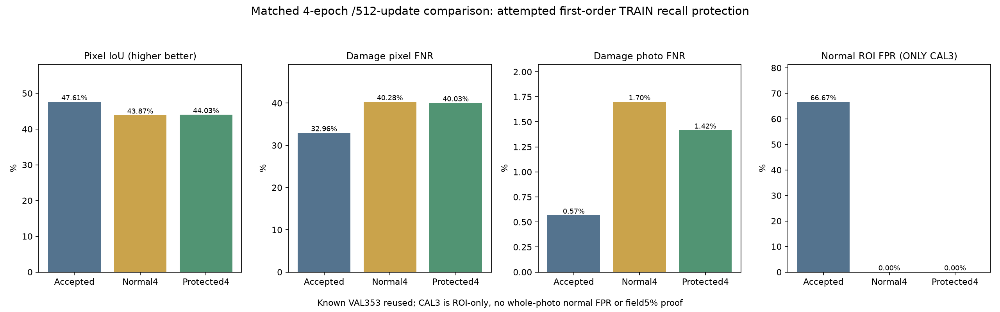

# 오탐 개선만 부분 반영할 수 있는가 · 실제 보정 학습 비교

기준일: 2026-10-13

## 요청에 대한 답

오탐과 미탐은 기능 스위치가 아니라 같은 가중치의 예측 결과다. 앞선 후보의 가중치를 그대로 적용하면 오탐 감소와 손상 미탐 증가가 함께 반영된다. **오탐을 줄이는 학습 방향 중 손상 탐지를 해치는 방향을 보정하는 방식**으로 부분 반영을 시도했고, 실제 검증 결과로 채택 여부를 결정했다.

## 같은 조건으로 실제 학습

**실제4epoch·512회 추가 학습**. 원래 선택한 native_mix에서 새로 시작했다. 앞서 미탐이 늘어난 normal_pilot 가중치에서 이어 학습한 것이 아니다. 동일한 사진·순서·seed443·학습률·손실·학습 횟수를 사용하고 가중치 변화 보정만 추가했다.

- 배치8: 기존 전체 손상사진4개·기존 contextual crop2개·작성자 정상 ROI2개. FIT14 정상 구역을1,024회 반복 사용했고 양성 사진은3,072draw다. 새 독립 사진·새 정답은 추가하지 않았다.
- 기존 양성 BCE20＋Dice＋교사 KL10＋정상 ROI 손실0.5는 그대로다. 별도로 작성자 정답의 양성 pixel 미탐 방향을 계산했다.
- Adam의 momentum·weight decay까지 포함한 실제 가중치 변화가 학습용 양성 pixel 손실을 일차 근사로 늘리는 경우, 그 방향을 제거했다. 저장된FP32 값으로 다시 검사했다. optimizer의 raw moment는 유지한다.
- 실제275/512업데이트를 보정했고, 전체 가중치를 되돌린 단계는0회다. 모든 저장된 변화에서 수치 조건을 확인했다. 실제 학습 시간1.39분.
- 이 수학적 조건은 TRAIN에서의 평균 양성 pixel 손실에 대한 일차 근사다. 검증·현장·사진 미탐을 보장하는 조건이 아니다. 미탐률을 실제로 다시 측정했다.
- [Yu 등, Gradient Surgery for Multi-Task Learning](https://arxiv.org/abs/2001.06782)의 충돌 방향 투영 아이디어를 참고했다. 원 논문의 대칭 PCGrad 구현과 같다고 주장하지 않는다. 여기서는 손상 재현을 우선한 한쪽 방향의 실제 parameter-step 보정이다.

## 실제 결과 · 같은 알려진 손상VAL353장

| 항목 | 현재 선택 모델 | 앞선 정상 학습 | 이번 미탐 방향 보정 |
|---|---:|---:|---:|
| 위치 IoU | 47.61% | 43.87% | 44.03% |
| 손상 pixel 미탐 | 32.96% | 40.28% | 40.03% |
| 배경 pixel 오탐 | 0.69% | 0.61% | 0.62% |
| 손상 사진 미탐 | 0.57% | 1.70% | 1.42% |
| 놓친 손상 사진 | 2/353 | 6/353 | 5/353 |
| 정답과 겹친 예측이 전혀 없음 | 28 | 34 | 34 |

알려진353장·4개 작성자 구간을 반복 사용한 비교다. 새 산업현장 검증이 아니다. 배경pixel 오탐은 손상사진 안의 mask 밖을 분모로 삼으며 정상 전체사진의 오탐과 다르다. 같은0.5 기준과 전체＋기존6구역 결합 정책을 유지했다.

## 정상 구역 비교 · CAL3개뿐

| 항목 | 현재 선택 모델 | 앞선 정상 학습 | 이번 미탐 방향 보정 |
|---|---:|---:|---:|
| 정상 구역에서 이상 후보 발생 | 2/3 | 0/3 | 0/3 |
| 정상 구역 오탐 비율 | 66.67% | 0.00% | 0.00% |
| 정상 전체사진 오탐 | 미측정 | 미측정 | 미측정 |

CAL3은 작성자normal bbox 내부 구역이다. 사진 전체 정상·기계 정상·독립 현장 정상의 정답이 아니다. 이3개에서0건이어도 산업현장 오탐0% 또는5% 미만을 검증한 것이 아니다. 보관 정상7개와 예약BeltCrack TEST는 모델 점수를 계산하지 않았다.

## 사전에 고정한 선택과 결과

기존 모델·정책·역할4 전달 ZIP을 유지한다.

연구 연결용 후보의 선택은 현재 모델 대비 IoU0.5%p 이상 개선, 배경 오탐·pixel 미탐·사진 미탐·정답 겹침 실패 유지, 작은 손상 IoU·pixel 미탐 유지, 각 촬영 구간 pixel 미탐 악화1%p 이내, 정상CAL 후보 발생 감소를 함께 요구했다. 결과에 맞춰 조건을 완화하지 않았다. CAL과 원래 구간 정보 부족으로 독립 현장 성능을 주장하거나 앱 기본 모델을 자동 교체하지 않는다.

| 조건 | 결과 |
|---|---|
| IoU_gain_at_least_half_percentage_point | 실패 |
| background_pixel_FPR_not_worse | 통과 |
| pixel_FNR_not_worse | 실패 |
| photo_FNR_not_worse | 실패 |
| zero_GT_overlap_not_worse | 실패 |
| small_damage_IoU_not_worse | 실패 |
| small_damage_pixel_FNR_not_worse | 실패 |
| each_known_sequence_pixel_FNR_within_one_percentage_point | 실패 |
| 정상CAL3 후보 발생 감소 | 통과 |

현재 선택 모델SHA `4b6d91c045cf6a33631ed5542c81d8e116166f541e97e6d745e1dfbe3f7fe5e5`; 정책SHA `c69054cd5699595741dadb3305f5072475fdc6559da24abd5cd14e2a17e90b66`. 이번 학습 파일SHA `4c23334a9d5fa649bcd721c03e52f2e4ef0134becca342afd8c314174d96ca81`.

## 재개·보존·한계

- 처음의 보정 구현은 첫 optimizer 호출에서FP32 수치 오차 조건을 만족하지 못했다. 그 시도는 저장된 checkpoint·완료 journal0회이며 제외했다. 소스·protocol·실패 기록은 보존했다. 실제 완료된 새학습512회와 제외된 호출1회를 구분한다.
- 별도v2에서FP32 쓰기 오차 경계에 따른 보정 여유와 검사 실패 시 정확한 이전 가중치 복원을 구현했다. 실제 학습에서는 복원 단계0회였고 처음 제안된 방향을 보정한275회는 완료된512회에 포함된다. 이 숫자는 실제journal과 비교한다.
- 기존 입력·모델·보고서50,319개의 SHA·수정시간과 기존Python소스464개의 SHA를 유지했다. 마지막progress와final이 같고 모든 비벨트tensor는 직전과 같다. 시설·이물질 CPU 출력의 정확 일치,3기능 CPU/GPU 및 원본 구역 CPU/GPU 일치를 확인했다.
- 교사는 학습 제약용으로만 사용한다. 선택된 추론은 모델 하나·공통 분석부 하나다. 내부 모터 고장·가동 상태·수리 완료를 새로 진단하는 모델이 아니다.
- 정상 구역 출처와 제안된frame 구간·중복·라이선스는 [앞선 실제 자료 검수](UNIFIED_BELT_NORMAL_RESULTS_KO.md)에 기록되어 있다. 원본 사진·정답은 Git이나 전달ZIP에 재배포하지 않는다.

- [사전 조건](unified-belt-recall-step-v2-protocol.json)
- [실제 학습 기록](unified-belt-recall-step-v2-training.json)
- [사진별 계수·CAL 구역 점수](unified-belt-recall-step-v2-validation.json)
- [선택 조건](unified-belt-recall-step-v2-selection.json)
- [보정·보존 검증](unified-belt-recall-step-v2-verification.json)
- [제외된 초기 시도](unified-belt-recall-step-excluded-attempt.json)
- [실행 파이프라인](../../docs/UNIFIED_BELT_RECALL_STEP_KO.md)
- [기존 출처·사용 조건](UNIFIED_MAIN_ATTRIBUTION_KO.md)
