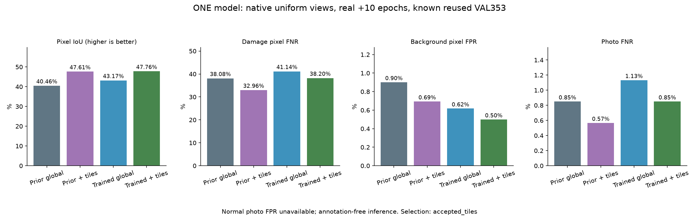

# 통합 메인 · 원본 구역 학습과 분석 비교

기준일: 2026-10-13

## 실제 수행

직전 native_mix 통합 모델에서 벨트 출력만 원본 구역 사진으로 실제 추가 학습했다. 공통 분석부·시설·이물질 가중치와 모든 BN 통계는 정확히 고정했다. 전체 사진과 구역 사진에 같은 모델 하나를 반복 사용하며 여러 모델을 묶은 ensemble이 아니다.

- **실제 추가10epoch·1,280회·2.65분**. 세 분석 설정을 비교하지만 추가 신경망 학습을3회 했다는 뜻이 아니다.
- 작성자 TRAIN1,397장의 원본·라벨·기존 전처리를 확인했다. 미리 정한 순서에서 사용할 파생 구역은3,957개이며 해당 구역의 작성자 mask가 비어 있는 경우는1,810개다. 이는 그 구역의 작성자 pixel 정답이며 전체 사진 정상/설비 정상 정답이 아니다.
- 새 독립 사진·새 정답은0개다. 배치8장 중4장은 기존 전체 사진,4장은 원본 구역이다. 추가 배경 penalty·교사를 넣지 않고 기존 BCE posweight20+Dice를 사용했다. 같은 원본 반복 추출을 새 사진으로 세지 않는다.
- 구역은 사진 크기로만 정한 최대6개 정사각형이다. 긴 변3개·짧은 변2개로 균등 배치하며 전체 사진을 덮는다. 손상 도형·예측 점수로 구역을 고르지 않는다. 학습 마스크는 원래 작성자 도형을 같은 좌표로 변환한다.
- 구역 분석은 각 구역 확률을 원본 좌표에서 Hann 가중평균으로 합친 뒤 기존640 유효 영역으로 옮긴다. 전체 확률50%와 구역 확률50%를 고정 평균하며 기준0.5는 그대로다. 작은 사진과3:1초과 비율은 전체 사진 분석으로 fallback한다.
- 마지막10회차만 평가했다. 각64회마다 재개 상태와 journal을 저장했다. epoch별VAL튜닝·예약TEST사용은 없다.

| 비교 설정 | 가중치 | 이번 실제 학습 | 벨트 분석 |
|---|---|---:|---|
| 기준 native_mix | 직전 가중치 | 0회 | 전체 사진만 |
| accepted_tiles | 직전과 동일 | 0회 | 전체 + 최대6구역 |
| trained_global | 이번 한 후보 | 1,280회 | 전체 사진만 |
| trained_tiles | trained_global과 동일 | 위1,280회 공유 | 전체 + 최대6구역 |

## 같은 알려진 VAL353장·4개 촬영 구간

작성자 원본 입력을 사용하되 평가 마스크와 분모는 기존640 raster grid를 유지했다. 구역을 고르거나 합치는 함수에는 정답을 넘기지 않는다. 알려진VAL을 재사용하는 연구 비교이며 독립 현장 시험이 아니다.

| 지표 | 기준 native_mix | accepted_tiles | trained_global | trained_tiles |
|---|---:|---:|---:|---:|
| 사진 미탐 | 0.85% | 0.57% | 1.13% | 0.85% |
| 사진 미탐 건수 | 3/353 | 2/353 | 4/353 | 3/353 |
| 손상 pixel 미탐 | 38.08% | 32.96% | 41.14% | 38.20% |
| 배경 pixel 오탐 | 0.90% | 0.69% | 0.62% | 0.50% |
| 위치 IoU | 40.46% | 47.61% | 43.17% | 47.76% |
| 정답 위치와 겹침 없는 손상 사진 | 37 | 28 | 38 | 38 |
| 정상 사진 오탐 | 미측정·정상0장 | 미측정·정상0장 | 미측정·정상0장 | 미측정·정상0장 |

픽셀 오탐과 정상 사진 오탐은 다른 지표다. 사진에서 후보를 찾더라도 정답 위치를 놓칠 수 있어서 위치IoU·pixel미탐·정답겹침실패도 함께 본다.

## 사전 선택 조건

선택: **accepted_tiles**. IoU 최소0.5%p 증가, 배경오탐·사진미탐·pixel미탐·정답겹침실패가 모두 기준보다 나빠지지 않아야 한다. 통과 설정은 IoU·낮은오탐·전체사진 방식 순으로 선택한다. 실패하면 직전 native_mix를 유지한다.

| 설정 | IoU +0.5%p | 배경 오탐 유지 | 사진 미탐 유지 | pixel 미탐 유지 | 겹침 실패 유지 |
|---|---|---|---|---|---|
| accepted_tiles | 통과 | 통과 | 통과 | 통과 | 통과 |
| trained_global | 통과 | 통과 | 실패 | 실패 | 실패 |
| trained_tiles | 통과 | 통과 | 통과 | 실패 | 실패 |

## 연결·보존·한계

기존 입력·모델/보고서49,831개와 Python소스435개를 SHA로 보존했다. 실제 journal은1,280회이고 최종 가중치는 마지막progress와 동일하다. 모든 비벨트tensor는 직전과 정확히 같고 기존 시설·이물질 CPU 예측 및3기능 CPU/GPU, 원본 구역 CPU/GPU 일치를 확인했다.

분석 설정은 가중치와 별개이므로 modelSha256과 inferencePolicySha256을 함께 기록한다. 동일한 가중치라도 구역 분석 방식이 다르면 정책SHA가 다르다. 기존 앱 기본 모델은 자동 교체하지 않는다.

정상벨트사진정답0장으로 정상 사진 오탐은 미측정이며 산업현장 전체5% 미만을 검증하지 못했다. 시설·이물질 수치는 기존 모델에서 계승하며 새시험이 아니다. 내부 모터·롤러 고장·가동 여부는 not_assessed다. 위험 등급·조치·요약은 기존 규칙 템플릿이고 점검자 확인이 필요하다.

- [사전 조건](unified-belt-tiles-protocol.json)
- [실제 학습 기록](unified-belt-tiles-training.json)
- [선택 조건별 결과](unified-belt-tiles-selection.json)
- [학습·재개·보존 검증](unified-belt-tiles-verification.json)
- [같은 가중치의 구역 분석 결과](unified-belt-tiles-accepted_tiles-validation.json)
- [학습 후 전체사진 결과](unified-belt-tiles-trained_global-validation.json)
- [학습 후 구역 분석 결과](unified-belt-tiles-trained_tiles-validation.json)
- [실행 파이프라인](../../docs/UNIFIED_BELT_TILES_STUDY_KO.md)
- [기준 native_mix 성능](UNIFIED_BELT_DETAIL_RESULTS_KO.md)
- [다른 기능 성능](UNIFIED_MAIN_RESULTS_KO.md)
- [출처·사용 조건](UNIFIED_MAIN_ATTRIBUTION_KO.md)

## 선택 버전과 점수 설명

최종 연결 버전은 기존 native_mix 가중치에 새 구역 분석을 적용한 accepted_tiles다. 이번에 실제 학습한1,280회 후보 가중치는 적용하지 않았다. 원본 사진을 서버에 보내며, 구역 분석은 전체 분석보다 계산량이 늘어난다.

구역 모드의 사진 점수는 원래640유효영역에서 최종융합확률의최댓값이다. 공통요약의single-view sigmoid문구는[설정별실제점수설명](unified-belt-tiles-score-scope.json)으로보완한다. 수치·기준·선택·가중치는변경하지않았다.
