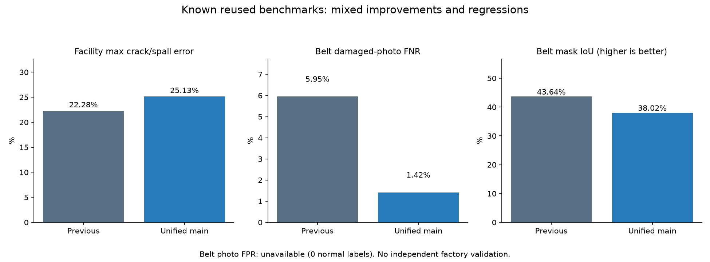

# 기존 메인 확장 · 실제 학습과 검증 결과

기준일: 2026-10-13

## 실제로 학습한 내용

기존 시설 연구 메인 `facility-presence-target-roi-control`의 공통 MobileNet 분석부와 시설 출력을 정확히 복사해 시작했다. 벨트 출력만 기존 벨트 모델에서 복사했고 이물질 출력은 새로 초기화했다. **공통 분석부 하나·체크포인트 하나·점검 기능3개**다. 학습 교사는 기존 메인 보존 손실에만 사용하며 배포 추론에 포함하지 않는다.

- 실제 학습: **20epoch·6,400회 가중치 업데이트·18.02분**. 사전 점검5회와 기준 보정은 이 횟수에서 제외했다.
- 실제 예약된 고유 TRAIN record: 시설9,305 + 벨트1,397 + 이물질4,558 = **15,260개**. CODEBRIM 출판자 patch도 포함되므로 모두 독립 전체 사진이라는 뜻은 아니다.
- 20회 반복 샘플링은51,200 draw이다. 반복 사용 횟수를 새 사진 수로 세지 않았다.
- 출처: DACL10k, DamSegment, CODEBRIM, BeltCrack, Mendeley 이물질 자료5개. PCB와 IDEA ND 보충자료는 이번 학습에 넣지 않았다.
- 시설7종과 DACL 보조19종, 벨트 작성자 손상 mask, 이물질 사진 유무를 사용했다. 확인하지 않은 항목은 unknown으로 유지했다.
- 최종 epoch20을 평가 전에 고정했다. 이물질 기준은 별도 CAL320장으로만 정했고 TEST는 학습·기준 보정에 사용하지 않았다.
- 기존 메인 SHA256: `0773b64f85bde27c256580be2fe36fabc0956c8b0bc3c087fc49716ba61d6c6a`.
- 최종 모델 SHA256: `362f9cab4a137419e63118f73b6b622dccfacc37c94a8f52af62f217b1491598`.

## 시설 · 같은 알려진 검증 사진과 기존 기준

시설 검증은 DACL710장·DamSegment424장·CODEBRIM611장이다. 균열 기준0.28985977, 박락0.46490818, 나머지5항목0.5를 이전 모델과 통합 모델에 동일하게 적용했다. 추가5항목의0.5는 최적화된 기준이라는 뜻이 아니다. unknown 항목은 분모에서 제외했다.

| 출처 | 항목 | 이전 오탐 | 통합 오탐 | 이전 미탐 | 통합 미탐 |
|---|---|---:|---:|---:|---:|
| dacl | 균열 | 22.04% (110/499) | 20.24% (101/499) | 22.27% (47/211) | 22.75% (48/211) |
| dacl | 박락 | 22.28% (86/386) | 25.13% (97/386) | 22.22% (72/324) | 20.37% (66/324) |
| dacl | 녹 얼룩 | 16.86% (58/344) | 17.73% (61/344) | 22.13% (81/366) | 23.22% (85/366) |
| dacl | 철근 노출 | 4.29% (27/630) | 4.13% (26/630) | 40.00% (32/80) | 40.00% (32/80) |
| dacl | 젖은 표면 | 7.49% (46/614) | 7.98% (49/614) | 43.75% (42/96) | 46.88% (45/96) |
| dacl | 백화 | 14.16% (78/551) | 13.07% (72/551) | 23.90% (38/159) | 22.01% (35/159) |
| dacl | 표면 공동 | 13.25% (80/604) | 14.24% (86/604) | 30.19% (32/106) | 30.19% (32/106) |
| damsegment | 균열 | 0.57% (1/176) | 1.14% (2/176) | 0.81% (2/248) | 0.81% (2/248) |
| damsegment | 박락 | 2.19% (8/366) | 2.46% (9/366) | 18.97% (11/58) | 18.97% (11/58) |
| damsegment | 녹 얼룩 | 측정 불가 (분모0) | 측정 불가 (분모0) | 측정 불가 (분모0) | 측정 불가 (분모0) |
| damsegment | 철근 노출 | 측정 불가 (분모0) | 측정 불가 (분모0) | 측정 불가 (분모0) | 측정 불가 (분모0) |
| damsegment | 젖은 표면 | 측정 불가 (분모0) | 측정 불가 (분모0) | 측정 불가 (분모0) | 측정 불가 (분모0) |
| damsegment | 백화 | 측정 불가 (분모0) | 측정 불가 (분모0) | 측정 불가 (분모0) | 측정 불가 (분모0) |
| damsegment | 표면 공동 | 측정 불가 (분모0) | 측정 불가 (분모0) | 측정 불가 (분모0) | 측정 불가 (분모0) |
| codebrim | 균열 | 12.55% (58/462) | 11.69% (54/462) | 7.38% (11/149) | 6.71% (10/149) |
| codebrim | 박락 | 8.92% (42/471) | 8.70% (41/471) | 10.71% (15/140) | 12.14% (17/140) |
| codebrim | 녹 얼룩 | 9.46% (44/465) | 9.68% (45/465) | 13.01% (19/146) | 11.64% (17/146) |
| codebrim | 철근 노출 | 2.13% (10/469) | 1.71% (8/469) | 11.27% (16/142) | 10.56% (15/142) |
| codebrim | 젖은 표면 | 측정 불가 (분모0) | 측정 불가 (분모0) | 측정 불가 (분모0) | 측정 불가 (분모0) |
| codebrim | 백화 | 8.51% (40/470) | 7.87% (37/470) | 17.73% (25/141) | 18.44% (26/141) |
| codebrim | 표면 공동 | 측정 불가 (분모0) | 측정 불가 (분모0) | 측정 불가 (분모0) | 측정 불가 (분모0) |

**균열·박락의12개 오탐·미탐률 중 최댓값은22.28%→25.13%로 악화했다.** 모든 시설 항목의 성능을 보존하거나 전체5% 미만을 달성한 모델로 해석할 수 없다.

## 벨트 · 같은 알려진 작성자 VAL353장

| 항목 | 이전 벨트 별도 모델 | 통합 메인 |
|---|---:|---:|
| 손상 사진 미탐 | 5.95% (21/353) | 1.42% (5/353) |
| 정상 사진 오탐 | 측정 불가·정상 정답0장 | 측정 불가·정상 정답0장 |
| 손상 mask pixel IoU | 43.64% | 38.02% |

손상 사진을 놓치는 비율은 줄었지만 **위치 겹침 IoU는 낮아졌다**. 이물질 없음 사진을 정상 벨트 정답으로 바꾸지 않았다. 정상 벨트의 사진 오탐률은0%가 아니라 미측정이다. 벨트 heatmap은 점검자 확인 자료이며 확정 손상 위치가 아니다.

## 이물질 · 이전 보정 별도 모델과 비교

| 알려진 시험 묶음 | 이전 오탐 | 통합 오탐 | 이전 미탐 | 통합 미탐 |
|---|---:|---:|---:|---:|
| 448장 | 0.78% (2/256) | 3.12% (8/256) | 0.00% (0/192) | 1.56% (3/192) |
| 783장 | 0.00% (0/399) | 1.50% (6/399) | 0.00% (0/384) | 0.26% (1/384) |

두 묶음은 이미 이전 실험에서 평가한 알려진 사진이며 같은4개 TEST 촬영 기록에서 나온 프레임이다. 이번 회차의 새로운 산업현장 검증이 아니다. 783장도 현재 시점에서 새 자료라고 부르지 않는다. 통합 수치는 이 묶음에서5% 미만이지만 이전 보정 별도 모델보다 악화했다. 프레임을 독립 현장·독립 물체 표본으로 해석하지 않는다.

## 결론과 앱 전달 범위

한 모델로5개 출처를 학습하는 구조와3개 기능 연결은 구현했다. 성능은 항목별로 개선과 악화가 함께 있다. **기존 앱 기본 모델은 교체하지 않았고 연구·연결 비교 후보로 제공한다. 산업현장 모든 항목의 오탐·미탐5% 미만은 달성하지 않았다.** 사진으로 모터·롤러 내부 고장이나 가동 안전을 판정하지 않는다.

비교에는 구조·초기 가중치·해상도·표본 배분 차이가 포함된다. 데이터 추가만의 효과를 입증한 실험은 아니다. 다음 성능 실험은 기존 시설 보존과 벨트 위치 악화를 함께 해결하도록 TRAIN에서 손실 비중·공통 분석부 업데이트 범위를 대조하고, 최종 검증용 현장 자료와 정상 벨트 정답을 별도로 확보하는 방향이 적절하다.

위험 등급·조치 문장·보고서 요약은 현재 규칙 템플릿이다. 학습한 위험 심각도 모델이나 생성형 보고서 모델이라고 표시하지 않는다. 조치 전후 비교는 같은 점검 후보의 변화이며 별도 학습한 수리 완료 판정 모델이 아니다.

- [실제 학습 기록](unified-main-training.json)
- [전체 계수와 분모](unified-main-results.json)
- [모델·입력 보존 확인](unified-main-verification.json)
- [실제 Qt/C++9개 테스트](unified-main-qt-tests-verified.json)
- [출처·사용 조건](UNIFIED_MAIN_ATTRIBUTION_KO.md)
- [역할4 연결 설명](../../docs/UNIFIED_MAIN_HANDOFF_KO.md)
