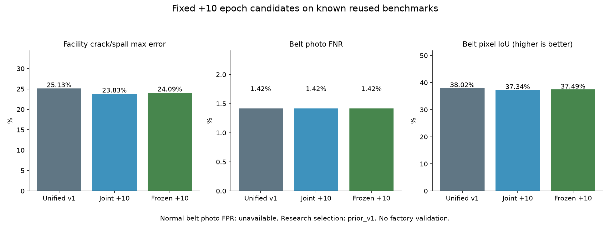

# 통합 메인 보존 대조 · 실제 결과

기준일: 2026-10-13

## 수행한 작업

같은 통합 v1 모델에서 두 후보를 실제로 추가 학습했다. 두 후보 모두 시설·벨트·이물질을 같은 공통 MobileNet 분석부 하나에 연결한다. joint는 공통 분석부까지 업데이트했고 frozen은 공통 가중치를 정확히 고정한 채 기능별 출력부만 학습했다. 앱에 두 후보를 동시에 로드하는 방식은 아니다.

- **후보마다10epoch·3,840회, 합계20후보 epoch·7,680회 추가 업데이트**. 이전 v1의20epoch·6,400회를 반복 실행한 수치가 아니다. 선택한 새 후보의 학습 이력은 v1의20회 + 추가10회다.
- 완료 업데이트 journal 집계: 7,680회. 사전 GPU 점검2회는 제외한다. 중단 후 버린 업데이트가 있으면 완료 모델에 반영된7,680회와 journal 수를 구분한다.
- 시설·벨트·이물질을 epoch당 각각1,024회 뽑았다. 두 후보의 원본, 정답, 순서, 학습률, 손실은 같고 공통 분석부 업데이트 여부만 다르다.
- DACL10k·DamSegment·CODEBRIM·BeltCrack·Mendeley 이물질5출처를 재사용했다. 고유 예약 TRAIN15,260 record이며 새 데이터·새 AI 정답은0개다. 일부는 작성자 patch로 독립 전체 사진 수와 다르다.
- 실제 데이터의 known은 좌표 mask가 아니라7개 클래스 플래그다. 원래 v1 처리대로 이미지·pixel target만 뒤집고 클래스 플래그는 유지한다. 두 후보에 같은 검증을 적용했다.
- 먼저 진행한 v2 부분 학습은 known을 좌표로 오해해 클래스 플래그를 반전한 오류가 있어 중단·제외했다. 해당2,179회 journal 업데이트와 중간 파일을 보존했으며 이번 유효 모델에 상속하지 않았다.
- 64회 업데이트마다 가중치·옵티마이저·현재 순서·난수 상태를 저장했다. 완료된 과거 모델과 결과는 SHA로 보존했다.

| 후보 | 실제 추가 회차 | 실제 업데이트 | 학습·CAL 시간 | 공통 분석부 변경 |
|---|---:|---:|---:|---|
| joint | 10 | 3,840 | 18.19분 | 변경 |
| frozen | 10 | 3,840 | 10.40분 | 전체 바이트 동일 |

## 시설 · 같은 알려진 VAL1,745장

이전 시설 기준을 그대로 사용한다. 아래는 항목별 오탐/미탐이며 unknown 항목은 분모에서 제외했다. 전체 정답 분모·FP·FN은 후보별 validation JSON에 있다.

| 출처 | 항목 | 통합 v1 오탐 / 미탐 | joint 오탐 / 미탐 | frozen 오탐 / 미탐 |
|---|---|---:|---:|---:|
| dacl | concrete_crack | 20.24% / 22.75% | 23.05% / 22.75% | 20.44% / 23.70% |
| dacl | concrete_spalling | 25.13% / 20.37% | 23.83% / 22.22% | 24.09% / 21.30% |
| dacl | rust_stain | 17.73% / 23.22% | 17.44% / 22.95% | 17.44% / 23.22% |
| dacl | exposed_rebar | 4.13% / 40.00% | 3.65% / 40.00% | 4.13% / 38.75% |
| dacl | wet_surface | 7.98% / 46.88% | 7.98% / 47.92% | 8.31% / 46.88% |
| dacl | efflorescence | 13.07% / 22.01% | 13.43% / 21.38% | 13.43% / 22.01% |
| dacl | surface_cavity | 14.24% / 30.19% | 13.91% / 32.08% | 13.91% / 31.13% |
| damsegment | concrete_crack | 1.14% / 0.81% | 1.14% / 0.81% | 1.14% / 0.81% |
| damsegment | concrete_spalling | 2.46% / 18.97% | 1.91% / 18.97% | 2.19% / 18.97% |
| damsegment | rust_stain | 미측정 / 미측정 | 미측정 / 미측정 | 미측정 / 미측정 |
| damsegment | exposed_rebar | 미측정 / 미측정 | 미측정 / 미측정 | 미측정 / 미측정 |
| damsegment | wet_surface | 미측정 / 미측정 | 미측정 / 미측정 | 미측정 / 미측정 |
| damsegment | efflorescence | 미측정 / 미측정 | 미측정 / 미측정 | 미측정 / 미측정 |
| damsegment | surface_cavity | 미측정 / 미측정 | 미측정 / 미측정 | 미측정 / 미측정 |
| codebrim | concrete_crack | 11.69% / 6.71% | 11.69% / 6.04% | 11.04% / 6.71% |
| codebrim | concrete_spalling | 8.70% / 12.14% | 8.49% / 11.43% | 8.70% / 11.43% |
| codebrim | rust_stain | 9.68% / 11.64% | 8.39% / 9.59% | 10.32% / 11.64% |
| codebrim | exposed_rebar | 1.71% / 10.56% | 1.92% / 11.27% | 1.71% / 9.86% |
| codebrim | wet_surface | 미측정 / 미측정 | 미측정 / 미측정 | 미측정 / 미측정 |
| codebrim | efflorescence | 7.87% / 18.44% | 7.45% / 17.73% | 8.30% / 17.73% |
| codebrim | surface_cavity | 미측정 / 미측정 | 미측정 / 미측정 | 미측정 / 미측정 |

## 벨트 · 같은 알려진 작성자 VAL353장

| 항목 | 통합 v1 | joint | frozen |
|---|---:|---:|---:|
| 사진 미탐 | 1.42% | 1.42% | 1.42% |
| 손상 위치 pixel IoU | 38.02% | 37.34% | 37.49% |
| 정상 사진 오탐 | 미측정·정상0장 | 미측정·정상0장 | 미측정·정상0장 |

사진 미탐과 손상 위치 성능을 함께 본다. 원본 픽셀의 background FPR을 정상 사진 FPR로 바꾸어 발표하지 않는다.

## 연구 후보 선택과 이물질 시험

사전에 등록한 VAL 조건에 따른 선택: **prior_v1**. 시설 균열·박락의 최대 오류, 벨트 사진 미탐과 위치 IoU가 통합 v1보다 나빠지지 않는 조건을 모두 확인했다. 둘 다 통과하지 않으면 v1을 유지한다. 이 선택을 저장한 뒤 이물질 TEST를 평가했고 시험 수치로 선택을 바꾸지 않았다.

| 알려진 시험 | 통합 v1 오탐 / 미탐 | joint 오탐 / 미탐 | frozen 오탐 / 미탐 |
|---|---:|---:|---:|
| common448 | 3.12% / 1.56% (정상256 / 이물질192) | 3.52% / 2.60% (정상256 / 이물질192) | 4.30% / 1.56% (정상256 / 이물질192) |
| known783 | 1.50% / 0.26% (정상399 / 이물질384) | 1.00% / 1.04% (정상399 / 이물질384) | 2.26% / 0.26% (정상399 / 이물질384) |

이물질 기준은 후보마다 별도 CAL320장에서 같은 알고리즘으로 정했다. CAL 재대입 수치는 성능 검증으로 쓰지 않는다. 두 TEST 묶음은 같은4개 알려진 촬영 기록의 프레임이며 독립 현장이나 이번 회차의 새 사진이 아니다.

## 전달과 다음 판단

연구 후보를 선택해도 기존 앱 기본 모델은 교체하지 않는다. 정상 벨트 정답과 독립 산업현장 검증이 없어 전체 항목 오탐·미탐5% 미만을 검증하지 못했다. 내부 모터·롤러 고장이나 정상 가동 여부도 사진으로 확정하지 않는다. 위험 등급·조치 문장·요약은 기존 규칙 템플릿이다.

추가 학습은 시설 비중을 높인 회차다. joint 대 frozen 비교는 같은 조건에서 공통 분석부 고정 효과를 보는 대조이며, v1 대비 결과를 데이터 추가만의 효과로 설명하지 않는다. 기존 v1의 known 처리는 올바른 처리였다.

- [유효 대조의 사전 등록 조건](unified-preservation-typed-protocol.json)
- [실제 정답 구조·클래스 플래그 보존](unified-preservation-known-scope.json)
- [잘못된 부분 학습의 중단·제외 기록](unified-preservation-v2-aborted.json)
- [선택 조건 통과·실패](unified-preservation-selection.json)
- [학습·입력·가중치 보존 검증](unified-preservation-verification.json)
- [joint 전체 VAL 계수](unified-preservation-joint-validation.json)
- [frozen 전체 VAL 계수](unified-preservation-frozen-validation.json)
- [출처와 사용 조건](UNIFIED_MAIN_ATTRIBUTION_KO.md)

## 학습 완료 후 보정 자료 표시의 복구

첫 후보의10회 학습이 끝난 뒤 CAL 관측값의 split 표시를 빠뜨려 보호 검사가 중단했다. 저장된 epoch11 상태로 재개한 뒤 정확한 CAL320 ID·라벨·순서와 TEST 미포함을 검사하고 같은 기준 보정 알고리즘을 실행했다. 신경망 업데이트는 재개 전후 모두3,840회로, 완료한 학습을 다시 돌리지 않았다. [보정 자료 표시·재개 기록](unified-preservation-calibration-provenance-fix.json)을 확인한다.

이번 유효 TRAIN에서 known은7개 클래스의 정답 사용 여부 벡터이고, 좌표 mask는7×80×80이다. 이전 v1의 처리가 맞았으며 일시적으로 잘못 바꾼 부분 학습만 제외했다. 기존 v1의 데이터·모델을 오류가 있었다고 재분류하지 않는다.

벨트 위치 누락도 남는다. 전체 손상 픽셀 미탐은 v1 48.61%, joint 50.41%, frozen 49.19%였다. 사진 미탐1.42%와 다른 수치이며 손상 위치를 찾았다는 뜻으로 합쳐 발표하지 않는다. 다음 대조는 작성자 TRAIN 손상 구역의 세부 학습과 해상도를 검토하는 방향이 적절하다. 이것은 후속 제안이며 이번 회차에서 해당 학습을 추가 실행한 것은 아니다.
