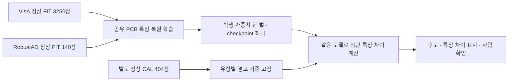

# 데이터셋과 모델의 관계

## 후속 대조 결과

두 통합 연구 후보를 각각10회 추가 학습했으나 벨트 위치 IoU가 기존보다 낮아져, 현재 사용할 모델 파일은 이전 통합 v1 하나로 유지한다. 한 모델 구조의 학습 방법을 비교한 것이며 앱에 두 모델을 추가한 작업이 아니다. [전체 결과](../ai-training/reports/UNIFIED_PRESERVATION_RESULTS_KO.md)를 확인한다.

## 현재 메인 연구 후보 · 2026-10-13

기존 시설 연구 메인 가중치를 정확히 복사해 시작하고3개 점검 출력을 한 모델 안에 넣었다. **한 MobileNet 공통 분석부·체크포인트 하나**를 실제5개 자료 출처로20epoch·6,400회 업데이트했다. 이번 추론에는 학습 교사를 로드하지 않는다.

| 같은 모델의 점검 출력 | 실제 자료 출처 | 실제 예약 고유 TRAIN record |
|---|---|---:|
| 시설 표면7종 | DACL10k·DamSegment·CODEBRIM | 9,305 |
| 벨트 손상 위치 | BeltCrack V1 | 1,397 |
| 철광석 흐름 이물질 유무 | Mendeley s25x2bnshz V1 | 4,558 |

세 출력은 같은 공통 분석부를 업데이트한다. 다른 항목에 정답이 없는 사진은 unknown이며 이물질 부재를 벨트 기계 정상이나 균열 음성으로 바꾸지 않았다. PCB와 IDEA ND 보충자료는 이 회차에 포함하지 않았다. 원본 수에 작성자 patch가 포함되며51,200 반복 draw를 새로운 독립 사진으로 세지 않는다.

벨트 미탐 감소와 시설·손상 위치 악화가 함께 있다. 기존 앱 기본 모델을 보존하고 이번 통합 모델을 연구 후보로 전달한다. APK·전 기능5% 미만·내부 고장 판정 기능을 완성했다는 뜻은 아니다.

- [통합 메인 전체 성능](../ai-training/reports/UNIFIED_MAIN_RESULTS_KO.md)
- [같은 모델3개 출력의 앱 연결](UNIFIED_MAIN_HANDOFF_KO.md)

## 이전 PCB 실험 및 별도 모델 이력 · 2026-10-12

| 점검 기능 | 실제 자료 출처 | 이전 모델 단위 |
|---|---|---|
| 회로기판 외관 이상 | VisA PCB1~4 + Amazon Science RobustAD PCB | 하나의 공유 PCB 검출 모델. 정상 FIT3,390장, 하나의 학생 가중치와 체크포인트 |
| 벨트 균열·찢어짐 | BeltCrack V1 | 별도 균열 위치 모델. 같은 출처의 원본을 늘린 것이며 여러 데이터셋 통합은 아님 |
| 철광석 흐름의 이물질 | Mendeley s25x2bnshz V1 | 별도 이물질 사진 분류 모델. 원본 추가와 검출 기준 보정은 각각 다른 단계 |
| 건물 표면 균열·박락 | 이전 여러 건물 자료를 통합한 실험 | 별도 건물 모델. 최근 산업 설비 모델의 데이터 출처로 합산하지 않음 |

PCB 두 출처 통합 실험 전에는 VisA PCB1~4마다 별도 학생 모델을 학습했다. 이번에는 그4유형과 새 RobustAD PCB 유형에 **같은 신경망**을 사용한다. 유형별 정상 CAL 경고 기준이 다른 것은 별도 신경망 모델을 학습했다는 뜻이 아니다.

## 새 PCB 학습 파이프라인

고정된 ImageNet 교사는 사전학습 특징을 제공하고 학생만 업데이트한다. 교사와 학생을 하나의 검출 모델 파일로 제공한다. ImageNet은 PCB 결함 정답 데이터셋으로 추가한 것이 아니다.

매 epoch 각 기판 유형800회로 균형 샘플링한다. 반복해서 뽑은160,000회를 새 원본160,000장으로 세지 않는다. 실제 고유 FIT은3,390장이고 CAL·TEST는 가중치 업데이트에 쓰지 않는다.

## 앱에서는 어떻게 사용하나

앱 AI 엔진은 설비 종류와 점검 항목에 맞춰 모델을 선택한다. PCB·벨트·이물질은 사진과 정답의 의미가 다르므로, 데이터 출처 이름만 제거해서 같은 정답으로 섞지 않는다. 새로운 데이터셋은 대상·손상 정의·정상 정답·사용 조건·중복·분리를 확인하고 같은 점검 기능에 추가한다.

학습 횟수와 원본 수가 증가했다고 성능 향상을 가정하지 않는다. 출처별 정상 오탐, 불량 미탐, 위치 성능을 따로 평가한다. 정상 정답이 없는 벨트 균열 자료의 사진 오탐은 산정 불가이며, 이물질 없음의 정답으로 이를 대신하지 않는다.

- [단일 PCB 모델 실제 학습·출처별 평가](../ai-training/reports/PCB_MULTISOURCE_RESULTS_KO.md)
- [역할4 단일 PCB 모델 API](PCB_MULTISOURCE_HANDOFF_KO.md)
- [기존 벨트 균열·이물질 보정 모델 API](FOREIGN_CALIBRATED_HANDOFF_KO.md)
