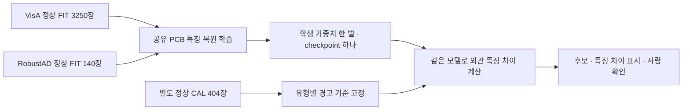

# 데이터셋과 모델의 관계

## 케이블·너트 사진15% 목표 보강 · 2026-10-14

정상FIT354장의 특징을 같은 공통 AI 분석부에 추가했다. 알려진 평가 사진에서 케이블 오탐10.34%·미탐7.61%, 너트 오탐13.64%·미탐11.83%를 측정했다.
신규11유형 중4개가 사진20% 이내이며 그중3개가15% 이내다. 이번 신경망 추가 업데이트0회이며 정상 특징 저장·정상CAL 기준 보정이다. 위치 표시는 기존 결과를 유지했다.
같은 공개TEST를 반복 사용한 개발 결과로 독립 현장 성능이 아니다. 사진 판별과 위치 성능을 구분한다.

- [케이블·너트 실제 보강 결과](../ai-training/reports/EQUIPMENT_REFERENCE_RESULTS_KO.md)

## 금속판 사진20% 목표 통과 · 2026-10-14

정상CAL사진만사용한기준조정으로금속판사진오탐3.85%·미탐18.31%를측정했다. 기존신경망가중치·금속판위치결과·다른유형의출력은유지했다. 이번추가신경망학습0회다.
신규11유형중부품표면15%목표와금속판20%목표가통과했다. 같은공개평가자료를재사용한비교이며독립현장검증은없다. 금속판pixel미탐27.96%는별도보강항목이다.

- [금속판 실제 보강 결과](../ai-training/reports/METAL_REFERENCE_RESULTS_KO.md)

## 산업 설비 전체 틀 확장 · 2026-10-14

사진오탐·미탐의1차목표를유형별20%이하,다음15%이하로정했다. 새4자료·11유형의실제사진6,602장을검수하고정상FIT3,056장으로한공통모델에30epoch·2,640회학습했다.
첫검증2199장에서20%기준과표본조건을만족한유형은1/11개다. 다른유형은보강/평가부족으로표시한다. 기존시설·벨트·이물질tensor와CPU출력을보존했고기존모델·앱기본값을자동교체하지않았다.

- [전체 틀·유형별 첫 성능](../ai-training/reports/EQUIPMENT_EXPANSION_RESULTS_KO.md)

## 사진별 손상 보호 비교 · 2026-10-13

실제 4epoch·512회 학습에서 배치 내 손상 사진 6개를 각각 보호했다. TRAIN 일차 근사 조건을 총 3072개 검사했다. 검증 미탐 보장 조건은 아니므로 같은 VAL353장과 정상 CAL3개로 비교했다.

현재/이번 손상 사진 미탐 2/1장(각353장), 정상 ROI 후보 2/0개(각3개). 기존 선택 모델과 역할4 전달 ZIP을 유지한다.

정상 전체사진 오탐과 독립 산업현장 전체5%는 미검증이다. 기존 시설·이물질 tensor를 보존했다. 보관7개·예약TEST의 모델 점수를 계산하지 않았다.

- [사진별 보호 측정 결과](../ai-training/reports/UNIFIED_BELT_PHOTO_GUARD_RESULTS_KO.md)

## 오탐 개선·미탐 방향 보정 비교 · 2026-10-13

오탐과 미탐은 같은 가중치의 결과라 오탐 개선만 복사할 수 없다. 같은 데이터로 **실제4epoch512회** 학습하면서 손상 탐지를 약화하는 방향275회를 보정했다. 검증 사진의 미탐 보장이 아니며 결과를 다시 비교했다.

현재/앞선정상학습/보정학습 손상사진 미탐: 2/6/5장(각353장). 정상CAL3의 이상 후보: 2/0/0개. 기존 모델·정책·역할4 전달 ZIP을 유지한다.

정상전체사진오탐은 미측정이고 산업현장 전체5% 검증은 없다. 시설·이물질 가중치를 보존했고 보관7개·예약TEST 모델 점수는 계산하지 않았다.

- [실제 오탐·미탐 비교](../ai-training/reports/UNIFIED_BELT_RECALL_STEP_RESULTS_KO.md)

## 신규 정상 구역 자료·초기 학습 · 2026-10-13

belt defects COCO ZIP497장·1,548장을 실제 받았고, 중복·라벨 겹침 검사 후 정상 구역24개(FIT14·CAL3·보관7)를 분리했다. **실제4epoch·512회 추가 학습**을 수행했다. 증강본과 반복draw를 새 독립 사진으로 세지 않는다. 사진 전체 정상·정상pixel mask 정답은 만들지 않았다.

정상 CAL 구역 이상 후보 2/3→0/3. 기존 손상VAL 위치 IoU 47.61%→43.87%, 손상사진 미탐2/353→6/353. CAL3개와 원래 촬영 구간 정보 부족으로 현재 모델·정책·전달ZIP을 유지했다.

정상 전체사진 오탐은 미측정이고 산업현장 전체5% 검증은 없다. 시설·이물질 가중치를 보존했다. 보관7개와 예약BeltCrack TEST의 모델 점수는 계산하지 않았다.

- [실제 다운로드·검수·학습 결과](../ai-training/reports/UNIFIED_BELT_NORMAL_RESULTS_KO.md)

## 양성 구역·예측 보존 추가 학습 · 2026-10-13

**실제6epoch·768회** 벨트 출력 추가 학습. 새 독립 사진·정답0개. 추가 학습 후보가 사전 조건을 모두 통과하지 못해 기존 accepted_tiles 모델·정책·전달 ZIP을 유지했다.

현재 선택 설정: 위치 IoU 47.61%, 손상pixel 미탐 32.96%, 배경pixel 오탐 0.69%, 손상사진 미탐 0.57%. 정상사진 오탐은 미측정이고 전체 산업현장5% 검증은 없다.

- [실제 학습·비교·선택](../ai-training/reports/UNIFIED_BELT_POSITIVE_RESULTS_KO.md)

## 세밀 구역 추론 비교 · 2026-10-13

같은 통합 모델로 더 작은 원본 구역을 보는2개 고정 설정을 비교했다. **추가 학습0회·새 독립 사진0장**이다. 기존 설정과 전달 ZIP을 유지한다.

선택 설정 위치 IoU 47.61%, 손상pixel 미탐 32.96%, 배경pixel 오탐 0.69%, 손상사진 미탐 0.57%. 정상사진 오탐은 미측정이고 전체 산업현장5% 검증은 없다.

- [실제 비교·오류 분석·선택](../ai-training/reports/UNIFIED_BELT_FINE_RESULTS_KO.md)

## 원본 구역 학습·분석 대조 · 2026-10-13

직전 모델에서 원본 구역 사진으로 벨트 출력을 **실제10epoch·1,280회** 추가 학습했다. 작성자 TRAIN1,397장과 파생 구역3,957개를 사용했으며 새 독립 사진·정답은0개다. 구역은 사진 크기로만 고른다.

| 같은 알려진 VAL353 | 직전 전체사진 | 직전 + 구역 | 학습 후 전체사진 | 학습 후 + 구역 |
|---|---:|---:|---:|---:|
| 사진 미탐 | 0.85% | 0.57% | 1.13% | 0.85% |
| 손상 pixel 미탐 | 38.08% | 32.96% | 41.14% | 38.20% |
| 배경 pixel 오탐 | 0.90% | 0.69% | 0.62% | 0.50% |
| 위치 IoU | 40.46% | 47.61% | 43.17% | 47.76% |

사전5조건을 통과한 **accepted_tiles**를 다음 연결 연구 설정으로 선택했다. IoU 최소0.5%p 개선과 배경오탐·사진미탐·pixel미탐·정답겹침실패 모두 유지하는 조건을 적용했다.

직전 + 구역은 가중치를 학습하지 않은 분석 방식 비교이고, 학습 후 두 설정은 이번에 한 번 학습한 같은 가중치다. 추론은 모델파일 하나를 반복 사용한다. 모델SHA와 분석정책SHA를 함께 기록한다.

모든 비벨트tensor와 시설·이물질 CPU 예측은 정확히 유지했다. 정상벨트사진오탐은 미측정이며 독립 산업현장5% 검증은 없다. 예약TEST는 사용하지 않았고 기존 앱 기본 모델은 자동 교체하지 않았다.

- [실제 학습·분석 비교·선택](../ai-training/reports/UNIFIED_BELT_TILES_RESULTS_KO.md)
- [파이프라인](UNIFIED_BELT_TILES_STUDY_KO.md)

## 벨트 배경 오탐 감소 대조 · 2026-10-13

직전 개선 모델에서 손상 보존 대조군과 배경 집중 후보를 각각 **10epoch·1,280회**, 합계 **2,560회** 실제 추가 학습했다. 같은 TRAIN1,397장과 원본 crop을 사용했으며 새 독립 사진·새 정답은 0개다.

| 같은 알려진 VAL353 | 직전 native_mix | 손상 보존 대조군 | 배경 집중 후보 |
|---|---:|---:|---:|
| 배경 pixel 오탐 | 0.90% | 0.67% | 0.60% |
| 손상 pixel 미탐 | 38.08% | 40.83% | 42.34% |
| 위치 IoU | 40.46% | 42.37% | 42.64% |
| 사진 미탐 | 0.85% | 0.85% | 1.13% |

두 후보가 모든 조건을 통과하지 못해 직전 native_mix 모델과 전달 ZIP을 유지했다. 배경 pixel 오탐을 상대10% 이상 줄이면서 IoU·사진 미탐·pixel 미탐·정답 위치 겹침 실패를 모두 유지하는 조건을 적용했다.

공통 분석부·시설·이물질 tensor와 기존 CPU 예측은 정확히 유지했다. 다른 기능 수치는 기존 모델에서 계승한 값이다. 학습 보존용 기준 모델은 추론에 추가하지 않는다.

정상 벨트 사진 오탐은 미측정이며 전체 산업현장 오탐·미탐5% 미만은 검증하지 못했다. 예약 TEST는 사용하지 않았다. 기존 앱 기본 모델은 자동 교체하지 않았다.

- [실제 비교·실패 조건·전체 계수](../ai-training/reports/UNIFIED_BELT_BACKGROUND_RESULTS_KO.md)
- [학습 파이프라인](UNIFIED_BELT_BACKGROUND_STUDY_KO.md)

## 벨트 출력만 추가 학습 · 2026-10-13

같은 통합 v1에서 전체 사진 control과 원본 손상 부위 혼합을 각각 **10epoch·1,280회**, 합계 **2,560회** 실제 추가 학습했다. TRAIN1,397장의 작성자 원본·라벨을 검증하고 원본 crop을 생성했다. 새 독립 사진·새 정답은0개다.

| 같은 알려진 VAL353 | 통합 v1 | 전체 사진 control | 원본 crop 혼합 |
|---|---:|---:|---:|
| 사진 미탐 | 1.42% | 1.42% | 0.85% |
| 위치 IoU | 38.02% | 37.54% | 40.46% |
| 손상 pixel 미탐 | 48.61% | 48.65% | 38.08% |
| background pixel 오탐 | 0.60% | 0.63% | 0.90% |

벨트 추가 학습 후보 **native_mix**를 다음 연결 연구 모델로 선택했다. 같은 모델 파일 하나·공통 분석부 하나로3개 점검 항목을 처리한다. 공통 분석부·시설·이물질의 모든 tensor와 기존 CPU 예측은 정확히 유지됐다. 다른 기능 수치는 기존 v1에서 계승한 것이며 새 현장 시험이 아니다.

원본 crop 혼합은 손상 pixel 미탐이 줄었지만 background pixel 오탐은 늘었다. 이 pixel 지표를 정상 사진 오탐률로 바꾸어 해석하지 않는다.

정상 벨트 오탐률은 미측정이고 전체 산업현장 오탐·미탐5% 미만은 검증하지 못했다. 예약 TEST는 사용하지 않았다. 기존 앱 기본 모델은 자동 교체하지 않았다.

- [실제 비교·선택·한계](../ai-training/reports/UNIFIED_BELT_DETAIL_RESULTS_KO.md)
- [파이프라인](UNIFIED_BELT_DETAIL_STUDY_KO.md)

## 이전 보존 대조 결과

두 통합 연구 후보를 각각10회 추가 학습했으나 벨트 위치 IoU가 기존보다 낮아져, 해당 대조에서는 이전 통합 v1 하나를 유지했다. 한 모델 구조의 학습 방법을 비교한 것이며 앱에 두 모델을 추가한 작업이 아니다. [전체 결과](../ai-training/reports/UNIFIED_PRESERVATION_RESULTS_KO.md)를 확인한다.

## 기준 통합 v1의 학습 · 2026-10-13

기존 시설 연구 메인 가중치를 정확히 복사해 시작하고3개 점검 출력을 한 모델 안에 넣었다. **한 MobileNet 공통 분석부·체크포인트 하나**를 실제5개 자료 출처로20epoch·6,400회 업데이트했다. 이번 추론에는 학습 교사를 로드하지 않는다.

| 같은 모델의 점검 출력 | 실제 자료 출처 | 실제 예약 고유 TRAIN record |
|---|---|---:|
| 시설 표면7종 | DACL10k·DamSegment·CODEBRIM | 9,305 |
| 벨트 손상 위치 | BeltCrack V1 | 1,397 |
| 철광석 흐름 이물질 유무 | Mendeley s25x2bnshz V1 | 4,558 |

세 출력은 같은 공통 분석부를 업데이트한다. 다른 항목에 정답이 없는 사진은 unknown이며 이물질 부재를 벨트 기계 정상이나 균열 음성으로 바꾸지 않았다. PCB와 IDEA ND 보충자료는 이 회차에 포함하지 않았다. 원본 수에 작성자 patch가 포함되며51,200 반복 draw를 새로운 독립 사진으로 세지 않는다.

벨트 미탐 감소와 시설·손상 위치 악화가 함께 있다. 기존 앱 기본 모델을 보존하고 이번 통합 모델을 연구 후보로 전달한다. APK·전 기능5% 미만·내부 고장 판정 기능을 완성했다는 뜻은 아니다.

- [통합 메인 전체 성능](../ai-training/reports/UNIFIED_MAIN_RESULTS_KO.md)
- [같은 모델3개 출력의 앱 연결](UNIFIED_MAIN_HANDOFF_KO.md)

## 이전 PCB 실험 및 별도 모델 이력 · 2026-10-12

| 점검 기능 | 실제 자료 출처 | 이전 모델 단위 |
|---|---|---|
| 회로기판 외관 이상 | VisA PCB1~4 + Amazon Science RobustAD PCB | 하나의 공유 PCB 검출 모델. 정상 FIT3,390장, 하나의 학생 가중치와 체크포인트 |
| 벨트 균열·찢어짐 | BeltCrack V1 | 별도 균열 위치 모델. 같은 출처의 원본을 늘린 것이며 여러 데이터셋 통합은 아님 |
| 철광석 흐름의 이물질 | Mendeley s25x2bnshz V1 | 별도 이물질 사진 분류 모델. 원본 추가와 검출 기준 보정은 각각 다른 단계 |
| 건물 표면 균열·박락 | 이전 여러 건물 자료를 통합한 실험 | 별도 건물 모델. 최근 산업 설비 모델의 데이터 출처로 합산하지 않음 |

PCB 두 출처 통합 실험 전에는 VisA PCB1~4마다 별도 학생 모델을 학습했다. 이번에는 그4유형과 새 RobustAD PCB 유형에 **같은 신경망**을 사용한다. 유형별 정상 CAL 경고 기준이 다른 것은 별도 신경망 모델을 학습했다는 뜻이 아니다.

## 새 PCB 학습 파이프라인

고정된 ImageNet 교사는 사전학습 특징을 제공하고 학생만 업데이트한다. 교사와 학생을 하나의 검출 모델 파일로 제공한다. ImageNet은 PCB 결함 정답 데이터셋으로 추가한 것이 아니다.

매 epoch 각 기판 유형800회로 균형 샘플링한다. 반복해서 뽑은160,000회를 새 원본160,000장으로 세지 않는다. 실제 고유 FIT은3,390장이고 CAL·TEST는 가중치 업데이트에 쓰지 않는다.

## 앱에서는 어떻게 사용하나

앱 AI 엔진은 설비 종류와 점검 항목에 맞춰 모델을 선택한다. PCB·벨트·이물질은 사진과 정답의 의미가 다르므로, 데이터 출처 이름만 제거해서 같은 정답으로 섞지 않는다. 새로운 데이터셋은 대상·손상 정의·정상 정답·사용 조건·중복·분리를 확인하고 같은 점검 기능에 추가한다.

학습 횟수와 원본 수가 증가했다고 성능 향상을 가정하지 않는다. 출처별 정상 오탐, 불량 미탐, 위치 성능을 따로 평가한다. 정상 정답이 없는 벨트 균열 자료의 사진 오탐은 산정 불가이며, 이물질 없음의 정답으로 이를 대신하지 않는다.

- [단일 PCB 모델 실제 학습·출처별 평가](../ai-training/reports/PCB_MULTISOURCE_RESULTS_KO.md)
- [역할4 단일 PCB 모델 API](PCB_MULTISOURCE_HANDOFF_KO.md)
- [기존 벨트 균열·이물질 보정 모델 API](FOREIGN_CALIBRATED_HANDOFF_KO.md)
