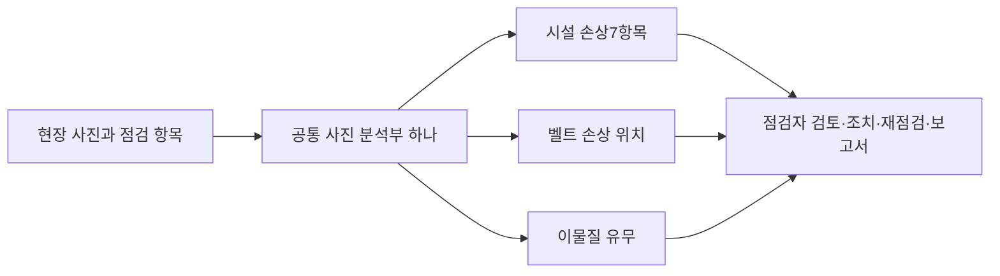

# 역할4 · 기존 메인을 확장한 통합 점검 모델

## 이번 모델 구성

기존 시설 사진·공간 특징 메인 계열의 `facility-presence-target-roi-control` 가중치를 정확히 복사해 시작했다. 기존7개 시설 출력과 보조 태그 출력을 유지하고 벨트 손상 위치 출력·이물질 사진 출력을 추가했다. **MobileNet 공통 분석부 하나·모델 파일 하나**이며, 별도 PCB 모델을 앱 메인이라고 바꿔 붙인 방식은 아니다.



20epoch·6,400회 실제 가중치 업데이트를 마쳤다. DACL·DamSegment·CODEBRIM·BeltCrack·Mendeley 이물질 자료가 같은 공통 분석부를 학습했다. 다른 점검 항목의 정답이 없는 사진은 해당 출력의 음성으로 바꾸지 않았다. 학습 중 기존 메인의 soft 예측은 보존 손실이며 새로운 정답이 아니다. 추론에는 그 학습 교사 모델을 로드하지 않는다.

성능은 [전체 결과](../ai-training/reports/UNIFIED_MAIN_RESULTS_KO.md)를 확인한다. 벨트 미탐은 줄었지만 위치 IoU와 일부 시설 항목은 악화했고, 이물질도 기존 별도 보정 모델보다 오류가 늘었다. 기존 모델과 앱 기본 프로필을 보존하고 이번 버전은 비교·연결용 연구 후보로 제공한다.

## 실행

`unified-main-role4-handoff-2026-10-13-v1.1.zip`을 새 폴더에 푼다. 모델은 `model.pt` 하나이며 선택 SHA는 `model.json`에 있다. Python3.12·CPU 실행 기준이다. 완전히 새 환경에서의 pip 설치 자체와 제작 환경의 실제 CPU 실행 시험은 구분한다.

```powershell
python -m venv .venv
.\.venv\Scripts\python.exe -m pip install torch==2.12.0 torchvision==0.27.0 --index-url https://download.pytorch.org/whl/cpu
.\.venv\Scripts\python.exe -m pip install -r requirements-api.txt
$mainModelRecord = Get-Content -Raw model.json | ConvertFrom-Json
.\.venv\Scripts\python.exe -m safelog_ai.unified_main_server --checkpoint $mainModelRecord.path --sha256 $mainModelRecord.sha256 --port 8775
```

`GET http://127.0.0.1:8775/health`에서 `ready=true`, `neuralModelCount=1`, `sharedBackboneCount=1`과 SHA를 확인한다. 기본 서버는 해당 PC의127.0.0.1에서 실행한다. 실제 스마트폰 연결에는 별도 서버 주소·인증·HTTPS 배포 구성이 필요하다. 스마트폰 내부 C++/ONNX 모델이나 완성 APK를 만든 버전은 아니다.

## 기존 Qt/C++ 앱 연결

[HTTP 어댑터 설정](../apps/mobile-qt/adapters/ai/http_ai_safety_analyzer.hpp)에 `inspectionTask`를 추가했고 [요청 코드](../apps/mobile-qt/adapters/ai/http_ai_safety_analyzer.cpp)가 위험 분석과 조치 전후 비교에 이 값을 보낸다. [앱 시작 코드](../apps/mobile-qt/app_controller.cpp)는 아래 환경변수를 읽는다.

```powershell
$env:SAFELOG_AI_BASE_URL="http://127.0.0.1:8775"
$env:SAFELOG_AI_INSPECTION_TASK="belt_damage"
# 이 환경에서 기존 safelog_mobile 앱을 실행한다.
```

점검 항목은 `facility_surface`, `belt_damage`, `conveyor_foreign`이다. 환경변수는 앱을 실행할 때의 점검 모드를 정하는 연결 방법이다. 촬영 화면에서 항목을 선택하고 점검 기록에 연결하는 UI/DB 작업은 역할1·2·4가 이어서 붙인다. 코드에서 사용할 때는 아래처럼 해당 사진의 점검 항목으로 어댑터를 구성한다.

```cpp
HttpAiSafetyAnalyzerConfig config;
config.baseUrl = "http://127.0.0.1:8775";
config.inspectionTask = "belt_damage";
HttpAiSafetyAnalyzer analyzer(config, makeQtJsonHttpClient());
auto suggestion = analyzer.analyzeHazard(photoPath, inspectorMemo);
```

점검 항목을 지정하지 않는 기존 서버용 호출 형식도 유지된다. 통합 서버는 명시적 항목을 요구하며 누락·지원하지 않는 항목은422를 반환한다. 사진을 보고 임의로 내부 고장 점검 종류를 선택하지 않는다.

## 요청과 응답

위험 분석은 기존 `POST /v1/analyze-hazard`를 사용한다. 별도 `POST /v1/main/analyze`도 같은 기능이다.

```json
{
  "image": "data:image/jpeg;base64,...",
  "inspectionTask": "conveyor_foreign",
  "userMemo": "점검자 메모",
  "promptVersion": "safelog-hazard-v1"
}
```

원본8MB·12MP 이내 JPEG/PNG, EXIF 방향 적용. 시설은 기존640 square bicubic, 벨트·이물질은640 letterbox 입력이다. 데이터셋 의미에 맞는 점검 항목을 선택한다. 이물질 모델의 적용 범위는 철광석 흐름의 근접 컨베이어 사진이다.

| 필드 | 앱 처리 |
|---|---|
| `schema` | `safelog.unified-main.v1` |
| `inspectionTask` | 이번에 평가한 점검 항목 |
| `neuralModelCount` / `sharedBackboneCount` | 모두1 |
| `modelName` / `modelSha256` | `unified-main-v1` / 같은 모델 SHA |
| `classResults` | 항목별 점수·고정 기준·후보 판정 |
| `candidateDetected` | 해당 점검 항목의 후보 유무 |
| `otherTasksEvaluated` | false. 다른 항목을 정상으로 저장하지 않음 |
| `heatmapPngBase64` | 벨트만 원본 크기의 회색 확인용 PNG. 시설·이물질은 null |
| `heatmapIsConfirmedDefectLocalization` | false |
| `mechanicalFailureState` | `not_assessed` |
| `humanConfirmationRequired` / `fieldPerformanceValidated` | true / false |
| `beltPhotoFprValidated` | false. 정상 벨트 사진 정답이 없어 오탐 미측정 |
| `confidence` / `scoreIsCalibratedProbability` | 기존 앱 호환용0~1 점수 / false. 정확도·고장 확률로 표시하지 않음 |

`hazardCategory`, `riskLevel`, `detectedHazards`, `suggestedDescription`, `suggestedAction`, `confidence`, `modelName`, `promptVersion`은 기존 C++ 응답 계약을 유지한다. 위험 등급·설명·조치 문장은 규칙 템플릿이며 별도로 학습한 위험 심각도 모델·LLM이 아니다. 앱에서는 점검자의 확인과 수정 후 저장한다.

`POST /v1/compare-action`은 `beforeImage`, `afterImage`, `inspectionTask`, `actionNote`, `promptVersion`을 받는다. 같은 고정 모델에서 조치 전 후보가 있고 조치 후 미검출일 때만 `likelyResolved=true`를 제안한다. 동일 사진 두 장은 해결로 판정하지 않는다. 별도로 학습한 변화 탐지·기계 고장 해결 모델은 아니며 점검자의 최종 확인이 필요하다.

`POST /v1/summarize`는 기존 `inspectionContext`·`promptVersion`을 받는다. 현재는 입력 기록을 정리하는 규칙 템플릿이며 `generationMethod=rule_template_not_trained_LLM`이다.

## 역할별 다음 연결

- **역할1:** 점검 항목 선택, AI 후보·벨트 확인용 위치 표시, 채택·수정·거절·판단 불가 화면. 미검출을 정상 가동으로 표시하지 않는다.
- **역할2:** 점검 항목·원본 SHA·모델 SHA·점수/기준·후보·사람 확인·조치 기록을 저장한다. 평가하지 않은 다른 항목은 미확인으로 유지한다.
- **역할3:** 단일 모델 실제 학습, 출처별 성능과 회귀 평가, SHA 고정 서버·C++ 연결 제공. 시설 오탐과 위치 성능 보강은 다음 실험으로 관리한다.
- **역할4:** 이 API를 기존 앱의 검토·조치 전후 비교·보고서 흐름에 연결하고 시연 패키지를 만든다. 이번 C++ 검증이 전체 Android APK 빌드 완료를 뜻하지는 않는다.

## 데이터와 전달 조건

학술·비상업 연구용으로 제공한다. DACL 원본 CC BY-NC4.0과 CODEBRIM의 비상업 교육·연구 조건을 함께 유지한다. CODEBRIM 조건은 원본 이미지 없이 학습 모델을 같은 조건으로 공유하는 것을 허용한다. ZIP에 원본 데이터셋은 넣지 않는다. BeltCrack는 CC BY-SA4.0, DamSegment·Mendeley 이물질 자료는 CC BY4.0이다. IDEA의 CC BY-NC-ND 보강 자료와 PCB 자료는 이번 메인 학습에 넣지 않았다.

출처·사용 조건·정답 변환은 [통합 출처 설명](../ai-training/reports/UNIFIED_MAIN_ATTRIBUTION_KO.md)에 기록한다. 기존 메인·벨트·이물질·PCB 전달 파일은 보존한다.
